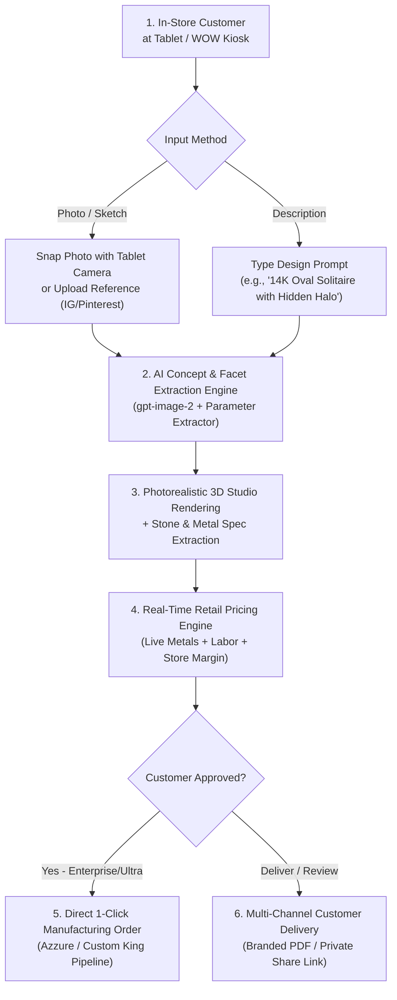

# Azzure AIQuote — Complete System Context & Documentation

## Quote Audit List/Detail Pricing Consistency (2026-09-28)

### User Evidence
- Screenshots showed unsaved analysis `VGM04E` with `$1,085.04` making price and `$1,808.40` selling price on `/admin/quotes`, while `/admin/quotes/unsaved/[analysisId]` showed `$1,265.88` for both values at a 0% jeweler margin.

### Root Cause and Fix
- The list calculation omitted the tenant's `pricingTier`, so `calculateMakingPrice` first applied its default Tier 2 divisor (`0.7`).
- The list then passed that already-tiered making price into `calculateTierPrice` using Tier 1 (`0.6`), applying the tier formula a second time and producing the incorrect `$1,808.40` selling value.
- The list now passes the tenant pricing tier directly to `calculateMakingPrice` and uses its returned `makingPrice`, `estimatedSellingPrice`, and `tierDivisor` without a second calculation.
- Renamed the list column from `Making Cost` to `Making Price` so it matches the actual tier-adjusted value and the detail audit terminology.

## Admin Activity Logging and IP Blocking (2026-09-28)

### Runtime Follow-up
- The first browser load failed with `Cannot read properties of undefined (reading 'findMany')` at `prisma.blockedIp.findMany` because the running Next.js process still held the Prisma client generated before `BlockedIp` was added.
- Stopped the stale Node process, regenerated Prisma Client successfully, confirmed both migrations were applied, and allowed the workspace process manager to restart Next.js on port 3000.
- Verified the exact runtime path directly: `prisma.blockedIp.findMany()` and `prisma.auditLog.count()` both completed successfully against the local PostgreSQL database.

### User Request
Extend the admin Logs dashboard with an option to block IP addresses and record broader activity, including which application pages users accessed.

### What Was Implemented
1. Expanded `/admin/logs` into three operational views: Activity, Sign-ins, and Blocked IPs.
   - Activity shows the latest 250 audit events, including user, action, accessed route/resource, tenant, IP, user-agent, and timestamp.
   - Sign-ins filters the same detailed table to successful `SIGN_IN` events.
   - Both tables are searchable by user name, email, event, IP, tenant, or route.
2. Added persistent IP access control.
   - Added Prisma model `BlockedIp` and migration `prisma/migrations/20260928001000_add_blocked_ip/migration.sql`.
   - Added `POST` and `DELETE` handlers at `/api/admin/logs/blocked-ips`.
   - Admins can block an address directly from an event row or enter an IPv4/IPv6 address with a reason in the Blocked IPs view.
   - The API rejects invalid addresses, duplicate blocks, and attempts to block the administrator's current IP.
3. Added request enforcement in `proxy.ts`.
   - Blocked addresses receive HTTP 403 for application pages and APIs.
   - Health checks, cron endpoints, and the Stripe billing webhook are exempt so infrastructure traffic cannot be disrupted by a user-facing block.
   - Blocked page/auth attempts are recorded as `BLOCKED_IP_ATTEMPT` events.
4. Added activity capture in `proxy.ts`.
   - Authenticated document and React Server Component navigations are recorded as `PAGE_VIEW` audit events.
   - Prefetch traffic, static assets, anonymous traffic, and API chatter are excluded to keep the trail useful and limit write volume.
   - Stored details include route, referrer path, application area, actor, tenant, IP, user-agent, and timestamp.
5. Added normalized IP handling in `lib/ip-access.ts` and Cloudflare header support in `lib/security.ts`.
6. Added `IP_BLOCKED`, `IP_UNBLOCKED`, `BLOCKED_IP_ATTEMPT`, and `PAGE_VIEW` audit actions.
7. Added focused IP-normalization coverage to `test/security.test.ts`.

### Operational Notes
- Run `prisma migrate deploy` before deploying the application code so `AuditLog.companyId` is nullable and the `BlockedIp` table exists.
- IP blocking is application-level. Network perimeter controls such as a CDN or firewall remain appropriate for high-volume abuse.
- Existing audit records remain visible; page-access records begin after this version is deployed.

## Admin Quote Audit Reference Match (2026-09-24)

- The supplied desktop reference is the design target for `/admin/quotes/[quoteId]`: dark operations rail, compact console header, five financial KPI cards, a live what-if pricing sandbox, a detailed cost ledger, tenant/specification context, imagery, and current market rates.
- The existing route remains data-driven and admin-only; the sandbox recalculates locally and never persists hypothetical edits.
- The audit layout now protects narrow-screen usability with single-column KPI/rate/image grids, wrapping notices, readable cost rows, and horizontally safe formulas.
- Interactive status messages use explicit live-region semantics, and motion honors the operating system reduced-motion preference.
- Pricing visibility is role-gated: public recipients, salespeople, viewers, and manufacturing users receive only the final selling price; owners, tenant admins, estimators, and legacy tenant customers may inspect the tier-adjusted jeweler cost breakdown.
- Restricted quote detail requests are sanitized at the server-component boundary so the making-price breakdown is not serialized into the client component tree.
- Admin audit KPIs now call the tier-adjusted value `Azzure Making Price` rather than the misleading `Production Cost`; the raw production subtotal remains internal to the admin ledger.

## Admin Sales AI Analysis Authentication Fix (2026-09-16)

- `/admin/sales` supplies `QuoteCalculator` with an `assignedCompanyId`: `INTERNAL` for a global estimate or a tenant ID for an assigned quote.
- `/api/analyze` uses this field to select the authorized admin-sales company context. Without it, the route falls back to tenant membership authentication.
- Internal administrators usually do not have a tenant membership, so a missing field caused a valid admin session to receive the misleading `Please sign in to continue.` error.
- Every photo-analysis request path now sends `assignedCompanyId`, whether or not an optional description is present.

## 1. Executive Summary & Vision

**Azzure AIQuote** is a B2B SaaS platform engineered for retail jewelry stores, luxury showrooms, and custom bridal boutiques. It is designed to run on showroom tablets and **WOW (Workstation on Wheels)** kiosks to transform the custom jewelry sales process from a 2–3 day waiting period into an **instant, high-converting 30-second in-store consultation**.

### Core Problem Solved
Traditional custom jewelry quoting requires sales associates to take photos or sketches, email CAD designers or casting houses, and wait days for estimates. Over 60% of bridal and custom shoppers lose interest or buy elsewhere during this delay. 

### The Solution
A touch-friendly showroom workstation where associates and walk-in customers can:
1. Snap a reference photo or type a dream design description.
2. View an instant **photorealistic 3D presentation rendering**.
3. Receive a **real-time retail price quote** calculated with live spot metal prices and the store's protected profit margin.
4. Dispatch the approved design into **Azzure / Custom King manufacturing** with 1 click.

---

## 2. End-to-End Workflow



### Step-by-Step Customer Journey
1. **Showroom Consultation (Dual Input)**:
   - **Reference Photos**: Drop or snap photos using the tablet's camera (`capture="environment"`).
   - **Design Idea Prompt**: Type or select from inspiration chips (*"14K Oval Solitaire with Hidden Halo"*, *"Platinum 3-Stone Emerald Cut"*, etc.).
2. **AI Concept Synthesis & 3D Render**:
   - Generates studio-grade portrait visualizations (`1024x1536`) with physically realistic reflections and neutral studio backdrops.
   - Extracts metal weight in grams, stone shapes, carats, clarity, and setting types.
3. **Dynamic Spot Pricing**:
   - Fetches live gold/platinum spot rates via `metals.dev` API.
   - Calculates metal cost, casting fees, stone-setting labor, CAD charges, and applies the jeweler's retail margin.
4. **Two Distinct Operational Modes**:
   - **In-Store Estimator Mode (Associate Back-Office View)**: The technical workbench where associates upload reference photos, review multi-pass AI diagnostics, adjust raw gram weights and stone quantities, configure margins, and inspect internal costs.
   - **Showroom Presentation Mode (Client-Facing Luxury Salon View)**: When turning the tablet toward the walk-in customer, one tap transforms the interface into a full-screen luxury presentation with the **Store's Custom Logo**, a **Hero 3D Portrait Frame**, **Interactive 1-Touch Metal Swatches (14K/18K/Platinum)**, **Live AI Design Tweaking**, **Grand Glowing Retail Price Typography**, and **Zero Internal Wholesale Formulas** visible.
5. **Customer Delivery & Sharing**:
   - **Branded Print PDF**: Export print-ready PDF proposals with store identity.
   - **Private Web Link (`/q/[token]`)**: Secure 30-day mobile links for customers to review at home.
6. **Manufacturing Order Fulfillment**:
   - 1-click submission directly into the Custom King manufacturing pipeline (`Submitted` $\rightarrow$ `CK Order Placed` $\rightarrow$ `In Production` $\rightarrow$ `Completed`).

---

## 3. Subscription Plans & Feature Matrix

| Feature | Starter ($49/mo) | Professional ($99/mo) | Enterprise ($199/mo) | Ultra ($399/mo) |
| :--- | :---: | :---: | :---: | :---: |
| **Quotes per Month** | 100 | 500 | 2,500 | 5,000 |
| **AI Analysis Passes** | 1-Pass | Full 3-Pass | 3-Pass + Override | 3-Pass + 3D Concept AI |
| **Real-Time Spot Metals** | Yes | Yes | Yes | Yes |
| **PDF Quote Export** | Watermarked | Custom Branded | Full White-Label | Full White-Label |
| **Quote Image History** | No | Yes (S3 Storage) | Yes (S3 Storage) | Yes (S3 Storage) |
| **Private Shareable Link** | No | No | Yes | Yes |
| **Manufacturing Orders** | No | No | Yes (1-Click CK) | Yes (1-Click CK) |
| **3D AI Concept Generation** | No | No | No | **Yes (`gpt-image-2`)** |
| **In-Store Showroom Mode** | No | No | No | **Yes (Tablet Kiosk)** |
| **Custom Store Logo/Branding**| No | Standard | Full White-Label | **Full Showroom Assets** |
| **Seat Limit** | 1 seat | 5 seats | Unlimited | Unlimited |
| **Support** | Standard Email | Priority Email | Dedicated Rep | 24/7 Dedicated Concierge |

---

## 4. Technology Stack & Architecture

- **Framework**: Next.js (App Router, Server Components & Route Handlers).
- **Language**: TypeScript (Strict mode, zero type errors).
- **Database & ORM**: PostgreSQL with Prisma ORM (`prisma/schema.prisma`).
- **Styling & Design System**: Modern High-Contrast Azure & Midnight Slate (`src/styles/design-tokens.css`, `app/globals.css`, WCAG AA/AAA compliant).
- **AI & Computer Vision**:
  - Image generation: OpenAI `gpt-image-2` (`lib/ai/quote-rendering.ts`, `app/api/concept/generate/route.ts`).
  - Analysis & Moderation: Multi-pass extraction pipeline (`lib/ai/runner.ts`, `lib/ai/schema.ts`).
- **Live Metal Pricing Engine**: `lib/metal-pricing.ts`, `src/services/pricing.ts` (Live `metals.dev` integration with offline fallback profile).
- **File & Media Storage**: AWS S3 client (`lib/quote-pdf-s3.ts`) with base64 data URL fallback.
- **PDF Generation**: `@react-pdf/renderer` (`lib/pdf/quote.ts`, `app/api/quotes/[quoteId]/pdf/route.ts`).
- **Billing & Subscriptions**: Stripe Checkout, Customer Portal, and Webhook synchronization (`lib/stripe.ts`, `src/stripe/plans.ts`).
- **Authentication & Multi-Tenancy**: NextAuth with isolated tenant context (`lib/company.ts`, `requireCompanyContext`).
- **Testing**: Vitest with 50+ unit and integration tests across pricing, feature gates, image rendering, and tenancy.

---

## 5. Codebase Structure & Key Files

```
azzure-autoquote-mvp/
├── app/
│   ├── (marketing)/             # Marketing, Pricing, and Trial Sign-up pages
│   │   ├── page.tsx             # Landing hero and feature showcase
│   │   ├── pricing/page.tsx     # 4-tier plan comparison (Starter, Pro, Enterprise, Ultra)
│   │   └── signup/page.tsx      # 14-day trial registration flow
│   ├── api/
│   │   ├── analyze/route.ts     # Multi-pass photo analysis endpoint
│   │   ├── concept/generate/    # Text-to-Jewelry AI 3D synthesis endpoint
│   │   ├── quotes/              # Quote persistence and PDF download routes
│   │   ├── orders/              # Manufacturing order placement to Custom King
│   │   └── settings/            # Branding, pricing margin, and team API routes
│   ├── quotes/
│   │   ├── page.tsx             # Quotes dashboard with search, status filters, and table
│   │   ├── new/page.tsx         # New quote builder workspace
│   │   └── [quoteId]/page.tsx   # Quote detail view with 1-click manufacturing order
│   ├── q/[token]/page.tsx       # Secure, responsive public customer share link
│   ├── customers/page.tsx       # Customer directory and quote history aggregator
│   ├── orders/page.tsx          # Manufacturing orders production pipeline
│   └── settings/
│       ├── billing/page.tsx     # Stripe subscription manager and upgrade modal
│       ├── branding/page.tsx    # Store logo, identity, and showroom branding
│       └── pricing/page.tsx     # Retail margin and pricing profile configuration
├── components/
│   ├── QuoteCalculator.tsx      # Core interactive quote builder (Dual-mode, Showroom toggle)
│   ├── workspace-shell.tsx      # Tenant shell with high-contrast Azure diamond brand mark
│   └── upgrade-modal.tsx        # Plan upgrade dialog
├── lib/
│   ├── ai/                      # OpenAI runner, prompt synthesizer, and schema validators
│   ├── metal-pricing.ts         # Live spot metal rates and calculations
│   ├── quote-pdf-s3.ts          # S3 storage adapters for images, renders, and PDFs
│   └── company.ts               # Multi-tenant context and permission enforcements
├── src/
│   ├── stripe/plans.ts          # Canonical plan definitions, limits, and feature gates
│   └── styles/design-tokens.css # Global design tokens, palettes, and typography
└── test/                        # Vitest unit and integration test suites
```

---

## 6. Comprehensive Go-To-Market (GTM) Campaign Plan

### Campaign Master Identity: *"The 30-Second Showroom Close" (Operation Zero Walkout)*
> **Headline**: *Stop Saying "Let Me Get Back to You."*  
> **Subheadline**: *The ultimate AI-powered pricing engine and 3D showroom kiosk for luxury jewelry retailers. Turn Pinterest and Instagram screenshots into closed $8,000 custom bridal sales in 30 seconds.*

---

### The 4 Major Industry Gaps Identified by Research
1. **The 48–72 Hour CAD Delay Trap**:
   - In-store bridal closing rate sits at **55%** during the consultation, but plummets to **<10%** once the customer walks out the door to wait for an emailed CAD quote.
2. **The $100–$300 Upfront CAD Expense**:
   - Jewelers pay freelance CAD designers before knowing if a client will purchase, burning $2,000–$4,000/month on lost leads.
3. **Gold Spot Volatility & Margin Leakage**:
   - With gold trading at all-time highs ($2,600+/oz), static paper sheets cause $300–$600 margin leakage on miscalculated metal weights.
4. **The Technical CAD "Imagination Gap"**:
   - Raw CAD wireframes look cold and industrial. Consumers need emotional, photorealistic 3D portrait renders with diamond fire and luxury reflections.

---

### Target Audience & ICP Breakdown
- **Tier 1 (Core)**: Independent Guild Jewelers (1–3 stores, $1M–$8M annual revenue, 20–60 custom bridal inquiries/mo).
- **Tier 2**: Bespoke Bridal Boutiques & Diamond District Showrooms.
- **Tier 3**: Multi-Location Jewelry Retailers & Diamond Wholesalers transitioning into custom retail.

---

### 5-Step High-Converting B2B Email Sequence
- **Email 1 (Day 1 - The Walkout Agitation)**: *"How many custom bridal sales walked out of [Store Name] this weekend?"*
- **Email 2 (Day 4 - The Financial ROI)**: *"The $2,500/month freelance CAD bill you can eliminate."*
- **Email 3 (Day 7 - The 28-Second Demo Video)**: *"Watch this 28-second custom ring quote on a showroom iPad."*
- **Email 4 (Day 11 - The Case Study)**: *"How a 2-store boutique closed $42,000 in custom bridal in 3 weeks."*
- **Email 5 (Day 15 - The Breakup / Final Call)**: *"Closing your file / Last check-in for [Store Name]."*

---

### Paid Video Ad Creative Assets (Meta / LinkedIn B2B)
- **Ad 1: Split-Screen Comparison (30s)**:
  - *Left*: Associate using paper notes, saying "I'll email you Tuesday," customer walks out.
  - *Right*: Associate taps showroom iPad, 3D ring sparkles with live spot pricing, customer hands over credit card.
- **Ad 2: Margin Guardian (45s)**:
  - Highlighting live gold spot sync against volatile markets to lock in 45%–55% profit margins.

---

### Channel Economics & Pilot Budget ($10,000 Pilot)
- **Meta / LinkedIn B2B Ads**: $7,000 (100,000+ impressions $\rightarrow$ 115 free trials).
- **Cold Email Outreach**: $1,500 (3,500 verified store owners $\rightarrow$ 45 free trials).
- **Trade Show & Collateral**: $1,500 ("The 10-Second Ring Challenge" iPad kiosk).
- **Expected Results**: 160 trial stores $\rightarrow$ 56 paid subscribers $\rightarrow$ **+$12,263 MRR (+$147k ARR)** at **$178 CAC** (Payback period < 1.2 months).

---

## 7. Future Roadmap & Planned Capabilities

### Phase 2: Interactive 3D WebGL Ring Builder
- Real-time Three.js 3D configurator on the tablet.
- 360-degree rotation with live component swapping (heads, prongs, halos, center stones, shanks, and metal purity) with instant price synchronization.

### Phase 3: On-the-Spot CAD & In-Store 3D Wax Printing
- Automatic manifold `.STL` CAD file generation.
- Direct 1-click dispatch to in-store 3D resin/wax printers (Formlabs, Asiga, Phrozen) so customers can physically try on a custom wax ring prototype in their finger size within 30 minutes.

### Phase 4: Augmented Reality (AR) Virtual Hand Try-On
- Tablet camera tracking (MediaPipe computer vision) allowing customers to see the 3D ring on their actual finger in real-time.

### Phase 5: Live Diamond Inventory Feeds (RapNet / VDB API)
- Connect center stone selections to live loose diamond vaults and grading reports (GIA/IGI).

### Phase 6: Custom King Live Creation Journey Portal
- Customer SMS updates tracking the physical manufacturing journey (*CAD Approved* $\rightarrow$ *Wax Printed* $\rightarrow$ *Cast in Gold* $\rightarrow$ *Diamonds Hand-Set* $\rightarrow$ *Ready for Pickup*).

---

## 8. Current Goals & Progress Summary

### Project Goals
1. **Approval Request Email Routing**: Send all new jeweler signup and account approval alert emails to `approvals@azzuresolutions.com` (configurable via `APPROVAL_ALERT_EMAIL`).
2. **CAD Currency Support for Canadian Customers & Jewelers**: Enable complete Canadian Dollar (CAD) currency display, conversion, and formatting options across quote calculators, public customer quote pages, cost breakdowns, and PDF exports so customers in Canada can view quotes and pricing in CAD.
3. **Frontend Redesign**: Full migration to Azzure AutoQuote luxury light-mode design system with responsive workspace sidebar and topbar navigation.
4. **Quote Dashboard Automation**: Auto-trigger AI analysis on photo/prompt input, hide AI notes by default with expandable toggle, and position Save/Download PDF actions on the right preview panel.
5. **Precious Metal Pricing Accuracy**: Include exact gold weight, 25%–28.5% casting wastage allowance, and live gold spot rates in all quote calculations.
6. **Showroom Kiosk WOW Experience**: Full luxury dark obsidian & gold theme with 4 1-tap end-customer try-it presets, camera support, auto-session resolution, and golden claim cards.
7. **Admin Operations Console Clean-Up**: Add Material Symbol navigation icons, soft status badges for platform health, financial market spot tickers, and quick shortcuts.
8. **CustomKing Manufacturing Order Studio**: Provide jewelers with an interactive manufacturing studio on approved quotes to review AI-detected specifications and customize production details (ring size, polish level, stone origin, engraving, delivery dates, provider) matching the CustomKing NYC integration schema.

### Progress Accomplished Till Now
- ✅ **Admin Currency Assignment on Customer Approval**: Implemented full currency assignment in the tenant approval workflow (`/admin/tenants/pending`, `/admin/tenants/[companyId]`, `/admin/companies/new`). Stored `currency` (`USD` or `CAD`) on `Company` in Prisma, and bound it to all quote surfaces so Canadian jewelers immediately see quotes and calculations in CAD by default.
- ✅ **Admin Login & Role Isolation Fix**: Fixed issue where logging in as `admin@azzure.com` loaded the Demo Jewelry tenant account instead of the Platform Admin Console. Standardized admin email recognition across all environments in `lib/internal-admin.ts`, decoupled internal admins from default tenant memberships in `auth.ts`, updated seed data in `prisma/seed.ts` & `prisma/seed.sql`, and routed admin logins directly to `/admin` in `components/sign-in-form.tsx`.
- ✅ **Approval Request Email Routing**: Configured `sendSignupApprovalAlert` in `lib/account-workflow.ts` to route all incoming signup and account approval alert emails directly to `approvals@azzuresolutions.com` (with `APPROVAL_ALERT_EMAIL` override support).
- ✅ **Complete CAD Currency Support**: Built centralized `lib/currency.ts` conversion & formatting engine and integrated interactive USD/CAD currency selectors across the Jeweler Quote Calculator (`components/QuoteCalculator.tsx`), Customer Public Quote Page (`app/q/[token]/page.tsx`), Quote Detail & Breakdown views (`app/quotes/[quoteId]/page.tsx`, `components/quote-cost-breakdown.tsx`), Quote PDF Generator (`lib/pdf/quote.ts`), and Showroom Kiosk (`app/showroom/showroom-kiosk.tsx`).
- ✅ **Redesigned Quote Calculator Dashboard**: Built 3-step left panel with automated analysis and real-time live preview panel.
- ✅ **Fixed Pricing Engine**: Added gold metal weight calculation, 25% casting loss factor, and standard lab diamond pricing ($125/ct center stone) in `src/services/pricing.ts`.
- ✅ **Fixed Metals.dev API 401 & Health Checks**: Sanitized API key quotes, added browser headers, and updated default offline fallback spot rate to $4,500/oz.
- ✅ **Luxury Onboarding Flow**: Completely redesigned `/onboarding` page and styling in `app/globals.css` with 3 guided steps, obsidian-gold glassmorphism cards, and real-time trial metric status banner.
- ✅ **Trial Duration & Days Remaining Fix**: Fixed `getTrialDaysRemaining` in `lib/billing.ts` and `lib/admin-companies.ts` to compute remaining trial days dynamically from `trialEndsAt`, `currentPeriodEnd`, or `currentPeriodStart + 14 days`, fixing the "0 days left" display.
- ✅ **Prisma Client Sync & DLL Lock Fix**: Resolved the runtime `Unknown argument 'renderingStatus'` error by stopping the locking Next.js dev server on Windows and regenerating the Prisma client (`npx prisma generate`).
- ✅ **Admin Sidebar High-Contrast Redesign**: Upgraded `.workspaceSidebar--admin` in `app/globals.css` with obsidian dark backdrop (`#0f172a`), luminous sapphire active states, crisp white headers, and distinct slate icons.
- ✅ **Showroom Save Quote Error Fix**: Fixed Zod schema in `app/api/showroom/quotes/route.ts` to support both `metalType` and `selectedMetal`, and updated `showroom-kiosk.tsx` payload.
- ✅ **Live Metal Price & Weight Density Sync**: Added automatic density conversion (`convertMetalWeight`) in both `QuoteCalculator.tsx` and `showroom-kiosk.tsx` and enhanced `calculateMetalCost` so prices update dynamically whenever metal (10K, 14K, 18K, Platinum, Silver) is selected.
- ✅ **Showroom Kiosk 10-Point Luxury Experience Complete**: Built a friction-free touchscreen experience meeting all customer trust standards: dedicated luxury welcome/standby screen with 1-tap start and 4 inspiration presets, photo upload + custom notes, animated progressive AI facet extraction, photorealistic 3D concept visualization render, instant live price updates without asterisks or small print, large glowing claim codes (e.g. `QT-0042`), explicit next-step guidance for the jeweler, and clean privacy reset with 90s inactivity timer.
- ✅ **CustomKing Integration API Endpoint Normalization**: Updated `lib/customking-api.ts` to automatically target CustomKing's `/api/v1/integration/orders` endpoint, preventing 404s and enabling live order creation from AutoQuote directly into the CustomKing staging manufacturing pipeline.
- ✅ **CustomKing Manufacturing Order Studio**: Built an interactive modal studio in `components/manufacturing-order-modal.tsx` on `/quotes/[quoteId]` that automatically pre-fills all AI-detected visual specifications (metal alloy, gram weight, diamond carats, shape, side stones, setting type, and 3D render) while allowing jewelers to customize production details (ring size, polish finish, diamond origin/color/clarity, stone provider, matching wedding band, engraving text and font, target delivery date, and workshop notes) before 1-click dispatching to CustomKing NYC.
- ✅ **Pricing Engine Formulas & Pricing Flow Overhaul**:
  - **Side Stone Pricing**: Round side stones = $80/ct; Non-round / fancy side stones (baguette, trapezoid, pear, emerald, etc.) = $130/ct.
  - **Side Stone Setting Labor**: Round side stones = $1.25/stone; Non-round side stones = $5.00/stone.
  - **CAD Design Fee**: Flat $20.00 default.
  - **3-Step Pricing Hierarchy**:
    1. **Production Subtotal** = Metal + Center Stone + Side Stone + Setting Labor + Wax ($15) + Polish ($20) + CAD ($20) *(Azzure raw manufacturing cost)*.
    2. **Azzure Making Price** = `Production Subtotal / Tier Divisor` (e.g. `Subtotal / 0.7` for Tier 2) *(Azzure wholesale invoice to jeweler)*.
- ✅ **Showroom Inspiration Product Catalog**:
  - Upgraded the landing standby screen below "Design Your Custom Ring" with 4 luxury handcrafted customer design products featuring studio jewelry photography, detailed descriptions, and live base price tags.
  - Tapping any catalog card instantly loads the piece specifications, photorealistic visual render, and interactive customizer into the showroom workspace.
- ✅ **Showroom AI Analysis Center Modal Popup ("What Our AI Sees")**:
  - Replaced the bottom inline card with a centered, glassmorphism modal dialog that appears during AI analysis, showing real-time animated scanning stages across metal alloy, diamond parameters, facet geometry, and spot pricing.
- ✅ **Rich Ring Specification Header**:
6. **Manufacturing Order Fulfillment**:
   - 1-click submission directly into the Custom King manufacturing pipeline (`Submitted` $\rightarrow$ `CK Order Placed` $\rightarrow$ `In Production` $\rightarrow$ `Completed`).

---

## 3. Subscription Plans & Feature Matrix

| Feature | Starter ($49/mo) | Professional ($99/mo) | Enterprise ($199/mo) | Ultra ($399/mo) |
| :--- | :---: | :---: | :---: | :---: |
| **Quotes per Month** | 100 | 500 | 2,500 | 5,000 |
| **AI Analysis Passes** | 1-Pass | Full 3-Pass | 3-Pass + Override | 3-Pass + 3D Concept AI |
| **Real-Time Spot Metals** | Yes | Yes | Yes | Yes |
| **PDF Quote Export** | Watermarked | Custom Branded | Full White-Label | Full White-Label |
| **Quote Image History** | No | Yes (S3 Storage) | Yes (S3 Storage) | Yes (S3 Storage) |
| **Private Shareable Link** | No | No | Yes | Yes |
| **Manufacturing Orders** | No | No | Yes (1-Click CK) | Yes (1-Click CK) |
| **3D AI Concept Generation** | No | No | No | **Yes (`gpt-image-2`)** |
| **In-Store Showroom Mode** | No | No | No | **Yes (Tablet Kiosk)** |
| **Custom Store Logo/Branding**| No | Standard | Full White-Label | **Full Showroom Assets** |
| **Seat Limit** | 1 seat | 5 seats | Unlimited | Unlimited |
| **Support** | Standard Email | Priority Email | Dedicated Rep | 24/7 Dedicated Concierge |

---

## 4. Technology Stack & Architecture

- **Framework**: Next.js (App Router, Server Components & Route Handlers).
- **Language**: TypeScript (Strict mode, zero type errors).
- **Database & ORM**: PostgreSQL with Prisma ORM (`prisma/schema.prisma`).
- **Styling & Design System**: Modern High-Contrast Azure & Midnight Slate (`src/styles/design-tokens.css`, `app/globals.css`, WCAG AA/AAA compliant).
- **AI & Computer Vision**:
  - Image generation: OpenAI `gpt-image-2` (`lib/ai/quote-rendering.ts`, `app/api/concept/generate/route.ts`).
  - Analysis & Moderation: Multi-pass extraction pipeline (`lib/ai/runner.ts`, `lib/ai/schema.ts`).
- **Live Metal Pricing Engine**: `lib/metal-pricing.ts`, `src/services/pricing.ts` (Live `metals.dev` integration with offline fallback profile).
- **File & Media Storage**: AWS S3 client (`lib/quote-pdf-s3.ts`) with base64 data URL fallback.
- **PDF Generation**: `@react-pdf/renderer` (`lib/pdf/quote.ts`, `app/api/quotes/[quoteId]/pdf/route.ts`).
- **Billing & Subscriptions**: Stripe Checkout, Customer Portal, and Webhook synchronization (`lib/stripe.ts`, `src/stripe/plans.ts`).
- **Authentication & Multi-Tenancy**: NextAuth with isolated tenant context (`lib/company.ts`, `requireCompanyContext`).
- **Testing**: Vitest with 50+ unit and integration tests across pricing, feature gates, image rendering, and tenancy.

---

## 5. Codebase Structure & Key Files

```
azzure-autoquote-mvp/
├── app/
│   ├── (marketing)/             # Marketing, Pricing, and Trial Sign-up pages
│   │   ├── page.tsx             # Landing hero and feature showcase
│   │   ├── pricing/page.tsx     # 4-tier plan comparison (Starter, Pro, Enterprise, Ultra)
│   │   └── signup/page.tsx      # 14-day trial registration flow
│   ├── api/
│   │   ├── analyze/route.ts     # Multi-pass photo analysis endpoint
│   │   ├── concept/generate/    # Text-to-Jewelry AI 3D synthesis endpoint
│   │   ├── quotes/              # Quote persistence and PDF download routes
│   │   ├── orders/              # Manufacturing order placement to Custom King
│   │   └── settings/            # Branding, pricing margin, and team API routes
│   ├── quotes/
│   │   ├── page.tsx             # Quotes dashboard with search, status filters, and table
│   │   ├── new/page.tsx         # New quote builder workspace
│   │   └── [quoteId]/page.tsx   # Quote detail view with 1-click manufacturing order
│   ├── q/[token]/page.tsx       # Secure, responsive public customer share link
│   ├── customers/page.tsx       # Customer directory and quote history aggregator
│   ├── orders/page.tsx          # Manufacturing orders production pipeline
│   └── settings/
│       ├── billing/page.tsx     # Stripe subscription manager and upgrade modal
│       ├── branding/page.tsx    # Store logo, identity, and showroom branding
│       └── pricing/page.tsx     # Retail margin and pricing profile configuration
├── components/
│   ├── QuoteCalculator.tsx      # Core interactive quote builder (Dual-mode, Showroom toggle)
│   ├── workspace-shell.tsx      # Tenant shell with high-contrast Azure diamond brand mark
│   └── upgrade-modal.tsx        # Plan upgrade dialog
├── lib/
│   ├── ai/                      # OpenAI runner, prompt synthesizer, and schema validators
│   ├── metal-pricing.ts         # Live spot metal rates and calculations
│   ├── quote-pdf-s3.ts          # S3 storage adapters for images, renders, and PDFs
│   └── company.ts               # Multi-tenant context and permission enforcements
├── src/
│   ├── stripe/plans.ts          # Canonical plan definitions, limits, and feature gates
│   └── styles/design-tokens.css # Global design tokens, palettes, and typography
└── test/                        # Vitest unit and integration test suites
```

---

## 6. Comprehensive Go-To-Market (GTM) Campaign Plan

### Campaign Master Identity: *"The 30-Second Showroom Close" (Operation Zero Walkout)*
> **Headline**: *Stop Saying "Let Me Get Back to You."*  
> **Subheadline**: *The ultimate AI-powered pricing engine and 3D showroom kiosk for luxury jewelry retailers. Turn Pinterest and Instagram screenshots into closed $8,000 custom bridal sales in 30 seconds.*

---

### The 4 Major Industry Gaps Identified by Research
1. **The 48–72 Hour CAD Delay Trap**:
   - In-store bridal closing rate sits at **55%** during the consultation, but plummets to **<10%** once the customer walks out the door to wait for an emailed CAD quote.
2. **The $100–$300 Upfront CAD Expense**:
   - Jewelers pay freelance CAD designers before knowing if a client will purchase, burning $2,000–$4,000/month on lost leads.
3. **Gold Spot Volatility & Margin Leakage**:
   - With gold trading at all-time highs ($2,600+/oz), static paper sheets cause $300–$600 margin leakage on miscalculated metal weights.
4. **The Technical CAD "Imagination Gap"**:
   - Raw CAD wireframes look cold and industrial. Consumers need emotional, photorealistic 3D portrait renders with diamond fire and luxury reflections.

---

### Target Audience & ICP Breakdown
- **Tier 1 (Core)**: Independent Guild Jewelers (1–3 stores, $1M–$8M annual revenue, 20–60 custom bridal inquiries/mo).
- **Tier 2**: Bespoke Bridal Boutiques & Diamond District Showrooms.
- **Tier 3**: Multi-Location Jewelry Retailers & Diamond Wholesalers transitioning into custom retail.

---

### 5-Step High-Converting B2B Email Sequence
- **Email 1 (Day 1 - The Walkout Agitation)**: *"How many custom bridal sales walked out of [Store Name] this weekend?"*
- **Email 2 (Day 4 - The Financial ROI)**: *"The $2,500/month freelance CAD bill you can eliminate."*
- **Email 3 (Day 7 - The 28-Second Demo Video)**: *"Watch this 28-second custom ring quote on a showroom iPad."*
- **Email 4 (Day 11 - The Case Study)**: *"How a 2-store boutique closed $42,000 in custom bridal in 3 weeks."*
- **Email 5 (Day 15 - The Breakup / Final Call)**: *"Closing your file / Last check-in for [Store Name]."*

---

### Paid Video Ad Creative Assets (Meta / LinkedIn B2B)
- **Ad 1: Split-Screen Comparison (30s)**:
  - *Left*: Associate using paper notes, saying "I'll email you Tuesday," customer walks out.
  - *Right*: Associate taps showroom iPad, 3D ring sparkles with live spot pricing, customer hands over credit card.
- **Ad 2: Margin Guardian (45s)**:
  - Highlighting live gold spot sync against volatile markets to lock in 45%–55% profit margins.

---

### Channel Economics & Pilot Budget ($10,000 Pilot)
- **Meta / LinkedIn B2B Ads**: $7,000 (100,000+ impressions $\rightarrow$ 115 free trials).
- **Cold Email Outreach**: $1,500 (3,500 verified store owners $\rightarrow$ 45 free trials).
- **Trade Show & Collateral**: $1,500 ("The 10-Second Ring Challenge" iPad kiosk).
- **Expected Results**: 160 trial stores $\rightarrow$ 56 paid subscribers $\rightarrow$ **+$12,263 MRR (+$147k ARR)** at **$178 CAC** (Payback period < 1.2 months).

---

## 7. Future Roadmap & Planned Capabilities

### Phase 2: Interactive 3D WebGL Ring Builder
- Real-time Three.js 3D configurator on the tablet.
- 360-degree rotation with live component swapping (heads, prongs, halos, center stones, shanks, and metal purity) with instant price synchronization.

### Phase 3: On-the-Spot CAD & In-Store 3D Wax Printing
- Automatic manifold `.STL` CAD file generation.
- Direct 1-click dispatch to in-store 3D resin/wax printers (Formlabs, Asiga, Phrozen) so customers can physically try on a custom wax ring prototype in their finger size within 30 minutes.

### Phase 4: Augmented Reality (AR) Virtual Hand Try-On
- Tablet camera tracking (MediaPipe computer vision) allowing customers to see the 3D ring on their actual finger in real-time.

### Phase 5: Live Diamond Inventory Feeds (RapNet / VDB API)
- Connect center stone selections to live loose diamond vaults and grading reports (GIA/IGI).

### Phase 6: Custom King Live Creation Journey Portal
- Customer SMS updates tracking the physical manufacturing journey (*CAD Approved* $\rightarrow$ *Wax Printed* $\rightarrow$ *Cast in Gold* $\rightarrow$ *Diamonds Hand-Set* $\rightarrow$ *Ready for Pickup*).

---

## 8. Current Goals & Progress Summary

### Project Goals
1. **Frontend Redesign**: Full migration to Azzure AutoQuote luxury light-mode design system with responsive workspace sidebar and topbar navigation.
2. **Quote Dashboard Automation**: Auto-trigger AI analysis on photo/prompt input, hide AI notes by default with expandable toggle, and position Save/Download PDF actions on the right preview panel.
3. **Precious Metal Pricing Accuracy**: Include exact gold weight, 25%–28.5% casting wastage allowance, and live gold spot rates in all quote calculations.
4. **Showroom Kiosk WOW Experience**: Full luxury dark obsidian & gold theme with 4 1-tap end-customer try-it presets, camera support, auto-session resolution, and golden claim cards.
5. **Admin Operations Console Clean-Up**: Add Material Symbol navigation icons, soft status badges for platform health, financial market spot tickers, and quick shortcuts.
6. **CustomKing Manufacturing Order Studio**: Provide jewelers with an interactive manufacturing studio on approved quotes to review AI-detected specifications and customize production details (ring size, polish level, stone origin, engraving, delivery dates, provider) matching the CustomKing NYC integration schema.

### Progress Accomplished Till Now
- ✅ **Redesigned Quote Calculator Dashboard**: Built 3-step left panel with automated analysis and real-time live preview panel.
- ✅ **Fixed Pricing Engine**: Added gold metal weight calculation, 25% casting loss factor, and standard lab diamond pricing ($125/ct center stone) in `src/services/pricing.ts`.
- ✅ **Fixed Metals.dev API 401 & Health Checks**: Sanitized API key quotes, added browser headers, and updated default offline fallback spot rate to $4,500/oz.
- ✅ **Luxury Onboarding Flow**: Completely redesigned `/onboarding` page and styling in `app/globals.css` with 3 guided steps, obsidian-gold glassmorphism cards, and real-time trial metric status banner.
- ✅ **Trial Duration & Days Remaining Fix**: Fixed `getTrialDaysRemaining` in `lib/billing.ts` and `lib/admin-companies.ts` to compute remaining trial days dynamically from `trialEndsAt`, `currentPeriodEnd`, or `currentPeriodStart + 14 days`, fixing the "0 days left" display.
- ✅ **Prisma Client Sync & DLL Lock Fix**: Resolved the runtime `Unknown argument 'renderingStatus'` error by stopping the locking Next.js dev server on Windows and regenerating the Prisma client (`npx prisma generate`).
- ✅ **Admin Sidebar High-Contrast Redesign**: Upgraded `.workspaceSidebar--admin` in `app/globals.css` with obsidian dark backdrop (`#0f172a`), luminous sapphire active states, crisp white headers, and distinct slate icons.
- ✅ **Showroom Save Quote Error Fix**: Fixed Zod schema in `app/api/showroom/quotes/route.ts` to support both `metalType` and `selectedMetal`, and updated `showroom-kiosk.tsx` payload.
- ✅ **Live Metal Price & Weight Density Sync**: Added automatic density conversion (`convertMetalWeight`) in both `QuoteCalculator.tsx` and `showroom-kiosk.tsx` and enhanced `calculateMetalCost` so prices update dynamically whenever metal (10K, 14K, 18K, Platinum, Silver) is selected.
- ✅ **Showroom Kiosk 10-Point Luxury Experience Complete**: Built a friction-free touchscreen experience meeting all customer trust standards: dedicated luxury welcome/standby screen with 1-tap start and 4 inspiration presets, photo upload + custom notes, animated progressive AI facet extraction, photorealistic 3D concept visualization render, instant live price updates without asterisks or small print, large glowing claim codes (e.g. `QT-0042`), explicit next-step guidance for the jeweler, and clean privacy reset with 90s inactivity timer.
- ✅ **CustomKing Integration API Endpoint Normalization**: Updated `lib/customking-api.ts` to automatically target CustomKing's `/api/v1/integration/orders` endpoint, preventing 404s and enabling live order creation from AutoQuote directly into the CustomKing staging manufacturing pipeline.
- ✅ **CustomKing Manufacturing Order Studio**: Built an interactive modal studio in `components/manufacturing-order-modal.tsx` on `/quotes/[quoteId]` that automatically pre-fills all AI-detected visual specifications (metal alloy, gram weight, diamond carats, shape, side stones, setting type, and 3D render) while allowing jewelers to customize production details (ring size, polish finish, diamond origin/color/clarity, stone provider, matching wedding band, engraving text and font, target delivery date, and workshop notes) before 1-click dispatching to CustomKing NYC.
- ✅ **Pricing Engine Formulas & Pricing Flow Overhaul**:
  - **Side Stone Pricing**: Round side stones = $80/ct; Non-round / fancy side stones (baguette, trapezoid, pear, emerald, etc.) = $130/ct.
  - **Side Stone Setting Labor**: Round side stones = $1.25/stone; Non-round side stones = $5.00/stone.
  - **CAD Design Fee**: Flat $20.00 default.
  - **3-Step Pricing Hierarchy**:
    1. **Production Subtotal** = Metal + Center Stone + Side Stone + Setting Labor + Wax ($15) + Polish ($20) + CAD ($20) *(Azzure raw manufacturing cost)*.
    2. **Azzure Making Price** = `Production Subtotal / Tier Divisor` (e.g. `Subtotal / 0.7` for Tier 2) *(Azzure wholesale invoice to jeweler)*.
- ✅ **Showroom Inspiration Product Catalog**:
  - Upgraded the landing standby screen below "Design Your Custom Ring" with 4 luxury handcrafted customer design products featuring studio jewelry photography, detailed descriptions, and live base price tags.
  - Tapping any catalog card instantly loads the piece specifications, photorealistic visual render, and interactive customizer into the showroom workspace.
- ✅ **Showroom AI Analysis Center Modal Popup ("What Our AI Sees")**:
  - Replaced the bottom inline card with a centered, glassmorphism modal dialog that appears during AI analysis, showing real-time animated scanning stages across metal alloy, diamond parameters, facet geometry, and spot pricing.
- ✅ **Rich Ring Specification Header**:
  - Added clean, informative jewelry specification headers directly beneath the live estimated price on both the Showroom Kiosk and Jeweler Workspace (e.g. *14K · 3.00ct Oval · 0.15ct Side Diamonds (16×) Custom Ring*).
- ✅ **Mobile QR Code Share & PDF Modal**:
  - Added **"Share with Others (Scan QR)"** below the Save Quote button.
  - Generates high-resolution client-side QR codes pointing to the public quote view (`/q/[code]`) with 1-click PDF download and copyable links for walk-in showroom customers.
- ✅ **Unified Text and Photo AI Analysis with Automatic 3D Rendering**:
- ✅ **Starter Plan PDF (No Image Box & Full Azzure Branding)**:
  - Omitted image placeholder boxes and extra reference pages on Starter plan PDFs (`hasPdfImages: false`).
- ✅ **Anti-Disposable & Anti-Dummy Email Filtering**:
  - Filtered out 100+ temporary email providers and placeholder dummy domains across signups, quotes, and showroom.
- ✅ **Default Root URL (`/`) Renders Interactive Luxury Landing Page**:
  - Direct integration into `app/page.tsx` with live interactive quoting presets.
- ✅ **Manual Spec Quoting Mode with Live Pricing Toggle on Jeweler Dashboard**:
  - Top segmented pill mode switcher on jeweler quote builder (`components/QuoteCalculator.tsx`).
- ✅ **August 2026 3-Tier Subscription Architecture Fully Implemented**:
  - Starter ($99/mo · 300 quotes), Professional ($199/mo · 1,200 quotes), Enterprise ($299/mo · 2,500 quotes).
- ✅ **Dynamic Hover Micro-Interactions on Pricing Cards & Comparison Table**:
  - Interactive row & column highlighting in `app/(marketing)/pricing/page.tsx`.
- ✅ **Showroom Logo Contrast & Admin Quotes Page Server Resilience**:
  - Wrapped showroom header logo in high-contrast `.showroomBrandLogoWrapper` with luminous pill background (`background: rgba(255, 255, 255, 0.96); padding: 6px 14px; border-radius: 10px; box-shadow: 0 4px 16px rgba(0,0,0,0.3)`) so dark / black-text logos are completely visible and crisp on dark showroom obsidian themes.
  - Hardened `app/admin/quotes/page.tsx` with comprehensive error handling, numeric CAD cost parsing, and item calculation safeguards.
- ✅ **Verification**: `npx tsc --noEmit` (0 errors), all 24 test suites passing (107/107 tests).

## Branding-to-showroom synchronization (2026-08-20)

- Showroom branding is loaded from the active session's current `Company` record on every dynamic `/showroom` request.
- The showroom header now renders the saved company name even when a store logo exists; previously the logo suppressed the name and made name changes appear stale.
- The saved primary brand color now sets the showroom's brand, light-accent, and glow CSS variables, including the main CTA.
- Customers can save a dedicated showroom background color from Branding Settings, preview their logo against it, and use either a light or dark showroom theme with automatic text contrast.
- Customers can also upload a private S3-backed showroom background image or looping muted video (JPG/PNG/WEBP/MP4/WEBM, up to 50 MB), served only through the active showroom token and displayed beneath a readability overlay.
- When S3 is unavailable during local development, showroom media automatically falls back to `.data/showroom-backgrounds/`; this directory is git-ignored and the same protected delivery endpoint is used.
## Launch-readiness audit (2026-08-20)

- Automated checks cover the production build, TypeScript, ESLint, 105 unit/integration tests, Prisma schema validation, and `npm audit`.
- Security hardening added active-token enforcement and bounded uploads to the phone-to-kiosk bridge, upload content-signature validation, fail-closed lifecycle cron authentication, sanitized database health errors, and production HSTS.
- Production deployment requires unique non-placeholder `AUTH_SECRET`, Stripe credentials/webhook secret, `BILLING_LIFECYCLE_SECRET` or `CRON_SECRET`, production `APP_URL`, database credentials, and the applicable email/AI/storage credentials.
- Admin order queries use explicit field projections rather than selecting every Company/Quote column, preventing unrelated newly-added columns from taking down the manufacturing queue while staged migrations are being rolled out.
## Margin, mobile navigation, and subscription alignment (2026-08-20)

- Customer retail margin is enforced at 50–200% in both UI and API; legacy company margins below 50% are migrated to 50%.
- Workspace and internal-admin pages expose a horizontally scrollable, touch-friendly mobile navigation bar whenever the desktop sidebar is hidden.
- Admin subscription selectors are restricted to the canonical Starter, Professional, and Enterprise plans. Legacy Enterprise Ultra subscriptions and pending changes migrate to Enterprise, and stale Ultra plan records are removed.
- The Proxmox Compose stack now gates app startup on a successful one-shot Prisma migration and canonical plan seed, covering Portainer/manual deployments as well as GitHub Actions.
- Admin tenant detail pages include a visible danger zone for permanent company deletion. Typed company-name confirmation invokes the existing cascade deletion workflow and redirects back to the tenant roster.
## Product identity (2026-08-20)

- The customer-facing application name is **Azzure AI Quote**.
- Product footers, public quotes, showroom mode, PDFs, and email messaging use the attribution **Built by azzuresolutions.com**.
- Internal package names, API user-agent identifiers, environment variables, database identifiers, and deployment paths retain their existing AutoQuote-based technical names to avoid unnecessary deployment risk.

## Expanded showroom appearance controls (2026-08-20)

- Enterprise customers can tune the showroom media overlay color and opacity, foreground text color, background image/video fit and focal position, and translucent content-panel strength.
- The controls have a live preview that uses the tenant's currently uploaded background image or video when an active showroom session exists.
- Settings are stored on `Company`, validated server-side, and applied to the public showroom through CSS variables. Uploaded media remains managed from Branding Settings.
- The former automatic white overlay for light background colors has been removed because it washed out photographic backgrounds and did not account for the actual image content.
- After adding the fields, the Windows development server retained a pre-generation Prisma model in Turbopack and raised `Unknown field showroomOverlayColor`. The repository's dev processes were fully stopped, the generated `.next` cache was moved to `.next.stale-showroom`, Prisma Client was regenerated, and the dev server was restarted successfully on port 3000.

## Admin Tenant Detail Error Resolution & Delete Company Visibility (2026-08-20)

- **Tenant Detail 500 Error Fix**: Resolved server crash on `/admin/tenants/[companyId]` by adding strict optional chaining (`subscription?.plan?.name`, `subscription?.plan?.code`) and defensive fallbacks across stats, pricing profiles, and recent activity so missing or unassigned plan/profile records never break the page.
- **Delete Company Multi-Location Access**:
  1. **Top Header Actions**: Added `AdminDeleteCompanyButton` directly to the top action row of `/admin/tenants/[companyId]` alongside "Edit billing" and "Open company context".
  2. **Bottom Danger Zone**: Enhanced the bottom danger zone with explicit permanent deletion details and modal confirmation.
  3. **Companies Roster (`/admin/companies`)**: Each row has a dedicated 1-click **Delete company** modal button in the Actions column.
- **Verification**: `npm test` passed 24 test suites (107/107 tests) and `npx tsc --noEmit` returned 0 errors.

## Genuine Email Verification & Auto-Deletion on Decline (2026-09-08)

### Goals
1. Prevent fake, spam, and bot registrations from creating unverified tenant records and polluting the admin approval queue.
2. Verify that registration emails are genuine and backed by active Mail Exchange (MX) DNS servers before creating accounts.
3. Defer platform admin signup notifications and pending approval queue listings until after the registrant has successfully verified their email address via OTP or magic link.
4. Ensure that declining a pending tenant approval automatically and permanently deletes the company, memberships, and orphan user from the PostgreSQL database, eliminating manual database deletion overhead.

### What Has Been Done Till Now
1. Investigated the root cause of the 14 fake tenant signups:
   - `POST /api/auth/register` created `Company` and `User` in `PENDING_APPROVAL` status immediately upon form submission without MX validation.
   - `sendSignupApprovalAlert` sent an admin email immediately upon registration, prior to email verification.
   - `getPendingApprovalCompanies()` listed all companies in `PENDING_APPROVAL` without checking `user.emailVerifiedAt`.
   - `app/api/admin/tenants/[companyId]/status/route.ts` only updated `accountStatus` to `SUSPENDED` when declining, leaving the tenant in the database.
2. Built `lib/email-mx-validation.ts` with real-time `dns.promises.resolveMx(domain)` lookup and disposable mail exchanger detection to reject non-existent, fake, and disposable domains upfront during registration (`POST /api/auth/register`).
3. Deferred platform admin signup alerts: removed premature `sendSignupApprovalAlert` from `POST /api/auth/register` and relocated it to `consumeEmailVerificationToken` in `lib/auth-tokens.ts` so admins are only alerted after the applicant verifies their email via OTP or magic link.
4. Gated the admin pending review queue: updated `getPendingApprovalCompanies()` in `src/services/admin-tenants.ts`, the pending badge count in `components/internal-admin-shell.tsx`, and `src/services/admin-overview.ts` to only include companies where the owner's email is verified (`emailVerifiedAt !== null`).
5. Implemented automatic database deletion on decline: updated `app/api/admin/tenants/[companyId]/status/route.ts` to handle `accountStatus: "DECLINED"` (and declining from pending status) by calling `deleteAdminCompany` to permanently purge the company, its cascading relations, and orphan user from PostgreSQL. Added `AdminDeclineTenantButton` with client confirmation prompt in `app/admin/tenants/pending/page.tsx` and added `?declined=1` success banner.
6. Added `cleanupStaleUnverifiedTenants` helper in `lib/admin-companies.ts` to automatically purge abandoned registrations older than 48 hours.
7. Verification:
   - Added `test/email-mx-validation.test.ts` (5 tests passing).
   - Added `test/admin-decline-tenant.test.ts` (3 tests passing).
   - `npm run typecheck` (`tsc --noEmit`) passed with 0 errors.
   - Full vitest suite passed 30 test files (148/148 tests).

## Upfront Stripe Checkout Gating & Existing Tenant Remediation (2026-09-08)

### Goals
1. Implement upfront Stripe Checkout card collection (Option 1) for all new registrations so accounts are only created in PostgreSQL after successful Stripe card authorization, preventing ghost accounts and fake signups.
2. Provide an in-app billing attention banner (Option A) in the workspace for existing trialing tenants without payment methods (e.g., *Premier Trading Corp* and *Diamond Tradex*).
3. Provide an admin-initiated Stripe Checkout session link generator (Option C) on `/admin/tenants/[companyId]` to copy or email checkout links to tenant owners.

### What Has Been Done Till Now
1. **PendingRegistration Model & Upfront Stripe Gate (Option 1)**:
   - Added `PendingRegistration` model in `prisma/schema.prisma` and created migration `prisma/migrations/20260908120000_add_pending_registration/migration.sql`.
   - Updated `app/api/checkout/route.ts` to perform MX DNS validation and store signup inputs in `PendingRegistration` with a 2-hour TTL. It initiates the Stripe Checkout Session with `pendingRegistrationId` and redirects to Stripe without creating `User`, `Company`, or `Subscription` records upfront.
   - Updated `lib/billing-webhooks.ts` (`handlePendingRegistrationProvisioning` in `syncStripeCheckoutSession` and webhook `checkout.session.completed`) to atomically provision the company, user, and subscription in PostgreSQL only after Stripe confirms valid card authorization.
   - Updated `app/onboarding/page.tsx` to automatically redirect newly provisioned users to `/verify-email?email=...` for OTP verification.
   - Sealed direct registration bypass in `app/api/auth/register/route.ts`.
2. **In-App Billing Attention Banner (Option A)**:
   - Updated `components/trial-banner.tsx` with `hasPaymentMethod?: boolean`. When false, it renders an attention banner: *"Action Required · Payment Method Needed"* with a direct *"Add payment details →"* button linking to `/settings/billing?upgrade=1`.
   - Propagated `hasPaymentMethod={Boolean(subscription?.stripeCustomerId)}` across `app/page.tsx`, `app/quotes/page.tsx`, `app/quotes/new/page.tsx`, and `app/settings/billing/page.tsx`.
   - Added an attention notice in `/settings/billing` informing the jeweler that a payment method is required to keep their workspace active after their trial.
3. **Admin Stripe Checkout Link Generator (Option C)**:
   - Created admin API endpoint `POST /api/admin/tenants/[companyId]/checkout-link` in `app/api/admin/tenants/[companyId]/checkout-link/route.ts` to generate a Stripe Checkout Session for any tenant missing payment details and optionally email it to the owner.
   - Created `AdminStripeCheckoutLink` client component in `components/admin-stripe-checkout-link.tsx` with 1-click **"Copy Link"** and **"Email Link to Owner"** capabilities.
   - Embedded `AdminStripeCheckoutLink` into `/admin/tenants/[companyId]` and `/admin/billing/[companyId]` whenever `subscription.stripeCustomerId` is missing.
4. **Verification**:
   - Added `test/admin-checkout-link.test.ts` (2 tests passing).
   - Added `test/checkout-gating.test.ts` (2 tests passing).
   - `npm run typecheck` passed with 0 errors.
   - 32 vitest test files passed (152/152 unit tests).

## Pricing Engine Double-Markup Elimination (2026-09-08)

### Goals
1. Eliminate the legacy `* finalMultiplier` (default 2x) multiplication in `calculateMakingPrice` (`src/services/pricing.ts`).
2. Ensure `estimatedSellingPrice = makingPrice + customerMarginAmount` so that Customer Margin % (0%, 50%, 100%) accurately and directly dictates retail prices.
3. Fix the visual math discrepancy where 0% customer margin displayed double the making price.

### What Has Been Done Till Now
1. Updated `src/services/pricing.ts` line 337: removed extraneous `* finalMultiplier` so `estimatedSellingPrice = Math.round((makingPrice + _customerMarginAmount) * 100) / 100`.
2. Added unit test in `src/services/pricing.test.ts` asserting that 0% customer margin yields an `estimatedSellingPrice` identical to `makingPrice` even when `pricingProfile.finalMultiplier` is 2.
3. Verification:
   - `npm run typecheck` passed with 0 errors.
   - Vitest suite passed: 32 test files (153/153 tests).


## Admin Login Logs Dashboard (2026-09-28)

### User Request
Create a new admin-side dashboard called "Logs" that shows all user login details, including which user logged in, which user-agent was used, and what IP address was used.

### Application Context
- The app is a Next.js 16 / React 19 app using NextAuth credentials authentication and Prisma/PostgreSQL.
- Admin pages live under `app/admin/*` and use `components/internal-admin-shell.tsx`.
- Admin navigation is centralized in `lib/internal-admin-nav.ts`.
- Existing audit storage is `AuditLog` in `prisma/schema.prisma`, with `action`, `actorUserId`, `companyId`, `metadata`, `ipAddress`, `userAgent`, and `createdAt`.
- Existing sign-in auditing was in `auth.ts` under the NextAuth `events.signIn` handler, but it only wrote rows when a tenant `companyId` existed and did not persist IP/user-agent request metadata.

### What Was Implemented
1. Added `/admin/logs` page at `app/admin/logs/page.tsx`.
   - Uses `InternalAdminShell`.
   - Requires admin route access for `/admin/logs`.
   - Shows summary cards for captured sign-ins, last-24-hour sign-ins, unique users, and unique IPs.
   - Shows a login activity table with user/name/email, access role, tenant or internal-admin context, IP address, user-agent, and timestamp.
2. Added "Logs" to admin navigation in `lib/internal-admin-nav.ts`.
   - Uses Material Symbols icon `manage_search`.
   - Allows `SUPER_ADMIN`, `SUPPORT_ADMIN`, and `OPERATIONS_MANAGER`.
3. Updated `auth.ts` sign-in auditing.
   - Reads IP from `cf-connecting-ip`, `x-forwarded-for`, `x-real-ip`, or `x-client-ip`.
   - Reads user-agent from the incoming credentials auth `Request`.
   - Truncates IP and user-agent values before storage.
   - Records successful `SIGN_IN` audit rows for tenant users and internal admins.
4. Updated `AuditLog` to allow system/admin auth events without a tenant.
   - `companyId` is now nullable in `prisma/schema.prisma`.
   - Added migration `prisma/migrations/20260928000000_make_audit_log_company_nullable/migration.sql`.
   - Updated `lib/audit.ts` so `companyId` can be omitted/null.
5. Updated `next-auth.d.ts`.
   - Added app-specific `User` fields used by auth callbacks and sign-in event logging, including `loginIpAddress` and `loginUserAgent`.

### Notes
- The dashboard shows successful sign-ins only. Failed login attempts are not captured by this change.
- New IP/user-agent details are populated for future sign-ins after deployment/migration. Existing `SIGN_IN` audit rows may show `Unknown` for those fields.


