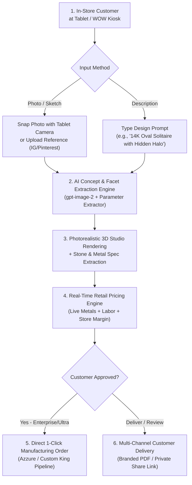

# Azzure AIQuote — Complete System Context & Documentation

## 1. Executive Summary & Vision

**Azzure AIQuote** is a B2B SaaS platform engineered for retail jewelry stores, luxury showrooms, and custom bridal boutiques. It is designed to run on showroom tablets and **WOW (Workstation on Wheels)** kiosks to transform the custom jewelry sales process from a 2–3 day waiting period into an **instant, high-converting 30-second in-store consultation**.

### Core Problem Solved
Traditional custom jewelry quoting requires sales associates to take photos or sketches, email CAD designers or casting houses, and wait days for estimates. Over 60% of bridal and custom shoppers lose interest or buy elsewhere during this delay. 

### The Solution
A touch-friendly showroom workstation where associates and walk-in customers can:
1. Snap a reference photo or type a dream design description.
2. View an instant **photorealistic 3D presentation rendering**.
3. Receive a **real-time retail price quote** calculated with live spot metal prices and the store's protected profit margin.
4. Dispatch the approved design into **Azzure / Custom King manufacturing** with 1 click.

---

## 2. End-to-End Workflow



### Step-by-Step Customer Journey
1. **Showroom Consultation (Dual Input)**:
   - **Reference Photos**: Drop or snap photos using the tablet's camera (`capture="environment"`).
   - **Design Idea Prompt**: Type or select from inspiration chips (*"14K Oval Solitaire with Hidden Halo"*, *"Platinum 3-Stone Emerald Cut"*, etc.).
2. **AI Concept Synthesis & 3D Render**:
   - Generates studio-grade portrait visualizations (`1024x1536`) with physically realistic reflections and neutral studio backdrops.
   - Extracts metal weight in grams, stone shapes, carats, clarity, and setting types.
3. **Dynamic Spot Pricing**:
   - Fetches live gold/platinum spot rates via `metals.dev` API.
   - Calculates metal cost, casting fees, stone-setting labor, CAD charges, and applies the jeweler's retail margin.
4. **Two Distinct Operational Modes**:
   - **In-Store Estimator Mode (Associate Back-Office View)**: The technical workbench where associates upload reference photos, review multi-pass AI diagnostics, adjust raw gram weights and stone quantities, configure margins, and inspect internal costs.
   - **Showroom Presentation Mode (Client-Facing Luxury Salon View)**: When turning the tablet toward the walk-in customer, one tap transforms the interface into a full-screen luxury presentation with the **Store's Custom Logo**, a **Hero 3D Portrait Frame**, **Interactive 1-Touch Metal Swatches (14K/18K/Platinum)**, **Live AI Design Tweaking**, **Grand Glowing Retail Price Typography**, and **Zero Internal Wholesale Formulas** visible.
5. **Customer Delivery & Sharing**:
   - **Branded Print PDF**: Export print-ready PDF proposals with store identity.
   - **Private Web Link (`/q/[token]`)**: Secure 30-day mobile links for customers to review at home.
6. **Manufacturing Order Fulfillment**:
   - 1-click submission directly into the Custom King manufacturing pipeline (`Submitted` $\rightarrow$ `CK Order Placed` $\rightarrow$ `In Production` $\rightarrow$ `Completed`).

---

## 3. Subscription Plans & Feature Matrix

| Feature | Starter ($49/mo) | Professional ($99/mo) | Enterprise ($199/mo) | Ultra ($399/mo) |
| :--- | :---: | :---: | :---: | :---: |
| **Quotes per Month** | 100 | 500 | 2,500 | 5,000 |
| **AI Analysis Passes** | 1-Pass | Full 3-Pass | 3-Pass + Override | 3-Pass + 3D Concept AI |
| **Real-Time Spot Metals** | Yes | Yes | Yes | Yes |
| **PDF Quote Export** | Watermarked | Custom Branded | Full White-Label | Full White-Label |
| **Quote Image History** | No | Yes (S3 Storage) | Yes (S3 Storage) | Yes (S3 Storage) |
| **Private Shareable Link** | No | No | Yes | Yes |
| **Manufacturing Orders** | No | No | Yes (1-Click CK) | Yes (1-Click CK) |
| **3D AI Concept Generation** | No | No | No | **Yes (`gpt-image-2`)** |
| **In-Store Showroom Mode** | No | No | No | **Yes (Tablet Kiosk)** |
| **Custom Store Logo/Branding**| No | Standard | Full White-Label | **Full Showroom Assets** |
| **Seat Limit** | 1 seat | 5 seats | Unlimited | Unlimited |
| **Support** | Standard Email | Priority Email | Dedicated Rep | 24/7 Dedicated Concierge |

---

## 4. Technology Stack & Architecture

- **Framework**: Next.js (App Router, Server Components & Route Handlers).
- **Language**: TypeScript (Strict mode, zero type errors).
- **Database & ORM**: PostgreSQL with Prisma ORM (`prisma/schema.prisma`).
- **Styling & Design System**: Modern High-Contrast Azure & Midnight Slate (`src/styles/design-tokens.css`, `app/globals.css`, WCAG AA/AAA compliant).
- **AI & Computer Vision**:
  - Image generation: OpenAI `gpt-image-2` (`lib/ai/quote-rendering.ts`, `app/api/concept/generate/route.ts`).
  - Analysis & Moderation: Multi-pass extraction pipeline (`lib/ai/runner.ts`, `lib/ai/schema.ts`).
- **Live Metal Pricing Engine**: `lib/metal-pricing.ts`, `src/services/pricing.ts` (Live `metals.dev` integration with offline fallback profile).
- **File & Media Storage**: AWS S3 client (`lib/quote-pdf-s3.ts`) with base64 data URL fallback.
- **PDF Generation**: `@react-pdf/renderer` (`lib/pdf/quote.ts`, `app/api/quotes/[quoteId]/pdf/route.ts`).
- **Billing & Subscriptions**: Stripe Checkout, Customer Portal, and Webhook synchronization (`lib/stripe.ts`, `src/stripe/plans.ts`).
- **Authentication & Multi-Tenancy**: NextAuth with isolated tenant context (`lib/company.ts`, `requireCompanyContext`).
- **Testing**: Vitest with 50+ unit and integration tests across pricing, feature gates, image rendering, and tenancy.

---

## 5. Codebase Structure & Key Files

```
azzure-autoquote-mvp/
├── app/
│   ├── (marketing)/             # Marketing, Pricing, and Trial Sign-up pages
│   │   ├── page.tsx             # Landing hero and feature showcase
│   │   ├── pricing/page.tsx     # 4-tier plan comparison (Starter, Pro, Enterprise, Ultra)
│   │   └── signup/page.tsx      # 14-day trial registration flow
│   ├── api/
│   │   ├── analyze/route.ts     # Multi-pass photo analysis endpoint
│   │   ├── concept/generate/    # Text-to-Jewelry AI 3D synthesis endpoint
│   │   ├── quotes/              # Quote persistence and PDF download routes
│   │   ├── orders/              # Manufacturing order placement to Custom King
│   │   └── settings/            # Branding, pricing margin, and team API routes
│   ├── quotes/
│   │   ├── page.tsx             # Quotes dashboard with search, status filters, and table
│   │   ├── new/page.tsx         # New quote builder workspace
│   │   └── [quoteId]/page.tsx   # Quote detail view with 1-click manufacturing order
│   ├── q/[token]/page.tsx       # Secure, responsive public customer share link
│   ├── customers/page.tsx       # Customer directory and quote history aggregator
│   ├── orders/page.tsx          # Manufacturing orders production pipeline
│   └── settings/
│       ├── billing/page.tsx     # Stripe subscription manager and upgrade modal
│       ├── branding/page.tsx    # Store logo, identity, and showroom branding
│       └── pricing/page.tsx     # Retail margin and pricing profile configuration
├── components/
│   ├── QuoteCalculator.tsx      # Core interactive quote builder (Dual-mode, Showroom toggle)
│   ├── workspace-shell.tsx      # Tenant shell with high-contrast Azure diamond brand mark
│   └── upgrade-modal.tsx        # Plan upgrade dialog
├── lib/
│   ├── ai/                      # OpenAI runner, prompt synthesizer, and schema validators
│   ├── metal-pricing.ts         # Live spot metal rates and calculations
│   ├── quote-pdf-s3.ts          # S3 storage adapters for images, renders, and PDFs
│   └── company.ts               # Multi-tenant context and permission enforcements
├── src/
│   ├── stripe/plans.ts          # Canonical plan definitions, limits, and feature gates
│   └── styles/design-tokens.css # Global design tokens, palettes, and typography
└── test/                        # Vitest unit and integration test suites
```

---

## 6. Comprehensive Go-To-Market (GTM) Campaign Plan

### Campaign Master Identity: *"The 30-Second Showroom Close" (Operation Zero Walkout)*
> **Headline**: *Stop Saying "Let Me Get Back to You."*  
> **Subheadline**: *The ultimate AI-powered pricing engine and 3D showroom kiosk for luxury jewelry retailers. Turn Pinterest and Instagram screenshots into closed $8,000 custom bridal sales in 30 seconds.*

---

### The 4 Major Industry Gaps Identified by Research
1. **The 48–72 Hour CAD Delay Trap**:
   - In-store bridal closing rate sits at **55%** during the consultation, but plummets to **<10%** once the customer walks out the door to wait for an emailed CAD quote.
2. **The $100–$300 Upfront CAD Expense**:
   - Jewelers pay freelance CAD designers before knowing if a client will purchase, burning $2,000–$4,000/month on lost leads.
3. **Gold Spot Volatility & Margin Leakage**:
   - With gold trading at all-time highs ($2,600+/oz), static paper sheets cause $300–$600 margin leakage on miscalculated metal weights.
4. **The Technical CAD "Imagination Gap"**:
   - Raw CAD wireframes look cold and industrial. Consumers need emotional, photorealistic 3D portrait renders with diamond fire and luxury reflections.

---

### Target Audience & ICP Breakdown
- **Tier 1 (Core)**: Independent Guild Jewelers (1–3 stores, $1M–$8M annual revenue, 20–60 custom bridal inquiries/mo).
- **Tier 2**: Bespoke Bridal Boutiques & Diamond District Showrooms.
- **Tier 3**: Multi-Location Jewelry Retailers & Diamond Wholesalers transitioning into custom retail.

---

### 5-Step High-Converting B2B Email Sequence
- **Email 1 (Day 1 - The Walkout Agitation)**: *"How many custom bridal sales walked out of [Store Name] this weekend?"*
- **Email 2 (Day 4 - The Financial ROI)**: *"The $2,500/month freelance CAD bill you can eliminate."*
- **Email 3 (Day 7 - The 28-Second Demo Video)**: *"Watch this 28-second custom ring quote on a showroom iPad."*
- **Email 4 (Day 11 - The Case Study)**: *"How a 2-store boutique closed $42,000 in custom bridal in 3 weeks."*
- **Email 5 (Day 15 - The Breakup / Final Call)**: *"Closing your file / Last check-in for [Store Name]."*

---

### Paid Video Ad Creative Assets (Meta / LinkedIn B2B)
- **Ad 1: Split-Screen Comparison (30s)**:
  - *Left*: Associate using paper notes, saying "I'll email you Tuesday," customer walks out.
  - *Right*: Associate taps showroom iPad, 3D ring sparkles with live spot pricing, customer hands over credit card.
- **Ad 2: Margin Guardian (45s)**:
  - Highlighting live gold spot sync against volatile markets to lock in 45%–55% profit margins.

---

### Channel Economics & Pilot Budget ($10,000 Pilot)
- **Meta / LinkedIn B2B Ads**: $7,000 (100,000+ impressions $\rightarrow$ 115 free trials).
- **Cold Email Outreach**: $1,500 (3,500 verified store owners $\rightarrow$ 45 free trials).
- **Trade Show & Collateral**: $1,500 ("The 10-Second Ring Challenge" iPad kiosk).
- **Expected Results**: 160 trial stores $\rightarrow$ 56 paid subscribers $\rightarrow$ **+$12,263 MRR (+$147k ARR)** at **$178 CAC** (Payback period < 1.2 months).

---

## 7. Future Roadmap & Planned Capabilities

### Phase 2: Interactive 3D WebGL Ring Builder
- Real-time Three.js 3D configurator on the tablet.
- 360-degree rotation with live component swapping (heads, prongs, halos, center stones, shanks, and metal purity) with instant price synchronization.

### Phase 3: On-the-Spot CAD & In-Store 3D Wax Printing
- Automatic manifold `.STL` CAD file generation.
- Direct 1-click dispatch to in-store 3D resin/wax printers (Formlabs, Asiga, Phrozen) so customers can physically try on a custom wax ring prototype in their finger size within 30 minutes.

### Phase 4: Augmented Reality (AR) Virtual Hand Try-On
- Tablet camera tracking (MediaPipe computer vision) allowing customers to see the 3D ring on their actual finger in real-time.

### Phase 5: Live Diamond Inventory Feeds (RapNet / VDB API)
- Connect center stone selections to live loose diamond vaults and grading reports (GIA/IGI).

### Phase 6: Custom King Live Creation Journey Portal
- Customer SMS updates tracking the physical manufacturing journey (*CAD Approved* $\rightarrow$ *Wax Printed* $\rightarrow$ *Cast in Gold* $\rightarrow$ *Diamonds Hand-Set* $\rightarrow$ *Ready for Pickup*).

---

## 8. Current Goals & Progress Summary

### Project Goals
1. **Frontend Redesign**: Full migration to Azzure AutoQuote luxury light-mode design system with responsive workspace sidebar and topbar navigation.
2. **Quote Dashboard Automation**: Auto-trigger AI analysis on photo/prompt input, hide AI notes by default with expandable toggle, and position Save/Download PDF actions on the right preview panel.
3. **Precious Metal Pricing Accuracy**: Include exact gold weight, 25%–28.5% casting wastage allowance, and live gold spot rates in all quote calculations.
4. **Showroom Kiosk WOW Experience**: Full luxury dark obsidian & gold theme with 4 1-tap end-customer try-it presets, camera support, auto-session resolution, and golden claim cards.
5. **Admin Operations Console Clean-Up**: Add Material Symbol navigation icons, soft status badges for platform health, financial market spot tickers, and quick shortcuts.
6. **CustomKing Manufacturing Order Studio**: Provide jewelers with an interactive manufacturing studio on approved quotes to review AI-detected specifications and customize production details (ring size, polish level, stone origin, engraving, delivery dates, provider) matching the CustomKing NYC integration schema.

### Progress Accomplished Till Now
- ✅ **Redesigned Quote Calculator Dashboard**: Built 3-step left panel with automated analysis and real-time live preview panel.
- ✅ **Fixed Pricing Engine**: Added gold metal weight calculation, 25% casting loss factor, and standard lab diamond pricing ($125/ct center stone) in `src/services/pricing.ts`.
- ✅ **Fixed Metals.dev API 401 & Health Checks**: Sanitized API key quotes, added browser headers, and updated default offline fallback spot rate to $4,500/oz.
- ✅ **Luxury Onboarding Flow**: Completely redesigned `/onboarding` page and styling in `app/globals.css` with 3 guided steps, obsidian-gold glassmorphism cards, and real-time trial metric status banner.
- ✅ **Trial Duration & Days Remaining Fix**: Fixed `getTrialDaysRemaining` in `lib/billing.ts` and `lib/admin-companies.ts` to compute remaining trial days dynamically from `trialEndsAt`, `currentPeriodEnd`, or `currentPeriodStart + 14 days`, fixing the "0 days left" display.
- ✅ **Prisma Client Sync & DLL Lock Fix**: Resolved the runtime `Unknown argument 'renderingStatus'` error by stopping the locking Next.js dev server on Windows and regenerating the Prisma client (`npx prisma generate`).
- ✅ **Admin Sidebar High-Contrast Redesign**: Upgraded `.workspaceSidebar--admin` in `app/globals.css` with obsidian dark backdrop (`#0f172a`), luminous sapphire active states, crisp white headers, and distinct slate icons.
- ✅ **Showroom Save Quote Error Fix**: Fixed Zod schema in `app/api/showroom/quotes/route.ts` to support both `metalType` and `selectedMetal`, and updated `showroom-kiosk.tsx` payload.
- ✅ **Live Metal Price & Weight Density Sync**: Added automatic density conversion (`convertMetalWeight`) in both `QuoteCalculator.tsx` and `showroom-kiosk.tsx` and enhanced `calculateMetalCost` so prices update dynamically whenever metal (10K, 14K, 18K, Platinum, Silver) is selected.
- ✅ **Showroom Kiosk 10-Point Luxury Experience Complete**: Built a friction-free touchscreen experience meeting all customer trust standards: dedicated luxury welcome/standby screen with 1-tap start and 4 inspiration presets, photo upload + custom notes, animated progressive AI facet extraction, photorealistic 3D concept visualization render, instant live price updates without asterisks or small print, large glowing claim codes (e.g. `QT-0042`), explicit next-step guidance for the jeweler, and clean privacy reset with 90s inactivity timer.
- ✅ **CustomKing Integration API Endpoint Normalization**: Updated `lib/customking-api.ts` to automatically target CustomKing's `/api/v1/integration/orders` endpoint, preventing 404s and enabling live order creation from AutoQuote directly into the CustomKing staging manufacturing pipeline.
- ✅ **CustomKing Manufacturing Order Studio**: Built an interactive modal studio in `components/manufacturing-order-modal.tsx` on `/quotes/[quoteId]` that automatically pre-fills all AI-detected visual specifications (metal alloy, gram weight, diamond carats, shape, side stones, setting type, and 3D render) while allowing jewelers to customize production details (ring size, polish finish, diamond origin/color/clarity, stone provider, matching wedding band, engraving text and font, target delivery date, and workshop notes) before 1-click dispatching to CustomKing NYC.
- ✅ **Pricing Engine Formulas & Pricing Flow Overhaul**:
  - **Side Stone Pricing**: Round side stones = $80/ct; Non-round / fancy side stones (baguette, trapezoid, pear, emerald, etc.) = $130/ct.
  - **Side Stone Setting Labor**: Round side stones = $1.25/stone; Non-round side stones = $5.00/stone.
  - **CAD Design Fee**: Flat $20.00 default.
  - **3-Step Pricing Hierarchy**:
    1. **Production Subtotal** = Metal + Center Stone + Side Stone + Setting Labor + Wax ($15) + Polish ($20) + CAD ($20) *(Azzure raw manufacturing cost)*.
    2. **Azzure Making Price** = `Production Subtotal / Tier Divisor` (e.g. `Subtotal / 0.7` for Tier 2) *(Azzure wholesale invoice to jeweler)*.
- ✅ **Showroom Inspiration Product Catalog**:
  - Upgraded the landing standby screen below "Design Your Custom Ring" with 4 luxury handcrafted customer design products featuring studio jewelry photography, detailed descriptions, and live base price tags.
  - Tapping any catalog card instantly loads the piece specifications, photorealistic visual render, and interactive customizer into the showroom workspace.
- ✅ **Showroom AI Analysis Center Modal Popup ("What Our AI Sees")**:
  - Replaced the bottom inline card with a centered, glassmorphism modal dialog that appears during AI analysis, showing real-time animated scanning stages across metal alloy, diamond parameters, facet geometry, and spot pricing.
- ✅ **Rich Ring Specification Header**:
  - Added clean, informative jewelry specification headers directly beneath the live estimated price on both the Showroom Kiosk and Jeweler Workspace (e.g. *14K · 3.00ct Oval · 0.15ct Side Diamonds (16×) Custom Ring*).
- ✅ **Mobile QR Code Share & PDF Modal**:
  - Added **"Share with Others (Scan QR)"** below the Save Quote button.
  - Generates high-resolution client-side QR codes pointing to the public quote view (`/q/[code]`) with 1-click PDF download and copyable links for walk-in showroom customers.
- ✅ **Unified Text and Photo AI Analysis with Automatic 3D Rendering**:
- ✅ **Starter Plan PDF (No Image Box & Full Azzure Branding)**:
  - Omitted image placeholder boxes and extra reference pages on Starter plan PDFs (`hasPdfImages: false`).
  - Rendered clean 1-page proposals featuring bold Azzure AutoQuote gold header branding and footer watermark (`"Powered by Azzure AutoQuote · AI Jewelry Quoting Engine · www.azzuresolutions.com"`).
- ✅ **Starter Plan Markup Customization Gating**:
  - Gated margin customization in `app/api/settings/pricing/route.ts` requiring `canUseCustomPricingProfile` (Professional, Enterprise, or Ultra).
  - Disabled slider and input controls in `app/settings/pricing/page.tsx` and `components/pricing-margin-simulator.tsx` for Starter plan users with an upgrade badge.
- ✅ **3D AI Concept Generation Restricted Strictly to Ultra Plan**:
  - Set `canGenerateAIImages: false` on Starter, Professional, and Enterprise plans (`src/stripe/plans.ts`). Only `plan_ultra` has `canGenerateAIImages: true`.
  - Enforced plan check in `lib/ai/quote-rendering.ts`, `app/api/concept/generate/route.ts`, and `app/api/analyze/route.ts`.
- ✅ **Anti-Disposable & Anti-Dummy Email Filtering**:
  - Created [`lib/email-validation.ts`](file:///d:/Projects/azzure-autoquote-mvp-starter/azzure-autoquote-mvp/lib/email-validation.ts) to filter out 100+ temporary email providers (mailinator, guerrillamail, 10minutemail, etc.), placeholder/dummy domains (`dsaf.com`, `example.com`, `test.com`, `dummy.com`, `fake.com`), and keyboard-mashing dummy emails.
  - Enforced across B2B jeweler signups (`POST /api/auth/register`, `/signup`), showroom kiosk quote saving (`POST /api/showroom/quotes`, `app/showroom/showroom-kiosk.tsx`), and jeweler dashboard quote builder (`POST /api/quotes`, `components/QuoteCalculator.tsx`).
- ✅ **Default Root URL (`/`) Renders Interactive Luxury Landing Page**:
  - Integrated [`components/InteractiveLandingPage.tsx`](file:///d:/Projects/azzure-autoquote-mvp-starter/azzure-autoquote-mvp/components/InteractiveLandingPage.tsx) directly into [`app/page.tsx`](file:///d:/Projects/azzure-autoquote-mvp-starter/azzure-autoquote-mvp/app/page.tsx) so that any unauthenticated visitor landing on the root URL (`/` or `http://localhost:3000/`) immediately receives the interactive showcase with live quoting presets, 6-second timed craftsperson hero mockup animation, interactive showroom kiosk walkthrough, and monthly/annual pricing calculator.
- ✅ **Resend Email Integration & Admin Customer Account Deletion**:
  - `lib/mailer.ts`: Built general `sendEmail` and `sendAuthMail` powered by Resend (`^6.18.1`), configurable via `RESEND_API_KEY` and `RESEND_FROM_EMAIL` in `.env` or `/admin/platform/settings`.
  - Added test email endpoint `POST /api/admin/test-email`.
  - Customer Account Deletion: Created REST endpoint `DELETE /api/admin/companies/[companyId]`, `POST /api/admin/companies/[companyId]/delete`, and member deletion `DELETE /api/admin/companies/[companyId]/members/[userId]` with automatic orphan user cleanup and interactive UI confirmation modals on `/admin/companies` and `/admin/companies/[companyId]`.
- ✅ **Verification**: `npx tsc --noEmit` (0 errors), all 23 test suites passing (102/102 tests).


