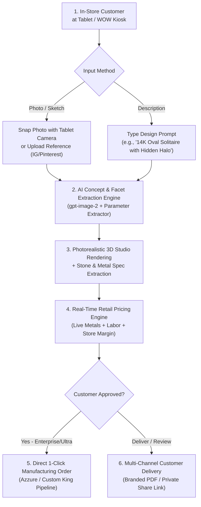

# Azzure AIQuote — Complete System Context & Documentation

## 1. Executive Summary & Vision

**Azzure AIQuote** is a B2B SaaS platform engineered for retail jewelry stores, luxury showrooms, and custom bridal boutiques. It is designed to run on showroom tablets and **WOW (Workstation on Wheels)** kiosks to transform the custom jewelry sales process from a 2–3 day waiting period into an **instant, high-converting 30-second in-store consultation**.

### Core Problem Solved
Traditional custom jewelry quoting requires sales associates to take photos or sketches, email CAD designers or casting houses, and wait days for estimates. Over 60% of bridal and custom shoppers lose interest or buy elsewhere during this delay. 

### The Solution
A touch-friendly showroom workstation where associates and walk-in customers can:
1. Snap a reference photo or type a dream design description.
2. View an instant **photorealistic 3D presentation rendering**.
3. Receive a **real-time retail price quote** calculated with live spot metal prices and the store's protected profit margin.
4. Dispatch the approved design into **Azzure / Custom King manufacturing** with 1 click.

---

## 2. End-to-End Workflow



### Step-by-Step Customer Journey
1. **Showroom Consultation (Dual Input)**:
   - **Reference Photos**: Drop or snap photos using the tablet's camera (`capture="environment"`).
   - **Design Idea Prompt**: Type or select from inspiration chips (*"14K Oval Solitaire with Hidden Halo"*, *"Platinum 3-Stone Emerald Cut"*, etc.).
2. **AI Concept Synthesis & 3D Render**:
   - Generates studio-grade portrait visualizations (`1024x1536`) with physically realistic reflections and neutral studio backdrops.
   - Extracts metal weight in grams, stone shapes, carats, clarity, and setting types.
3. **Dynamic Spot Pricing**:
   - Fetches live gold/platinum spot rates via `metals.dev` API.
   - Calculates metal cost, casting fees, stone-setting labor, CAD charges, and applies the jeweler's retail margin.
4. **Two Distinct Operational Modes**:
   - **In-Store Estimator Mode (Associate Back-Office View)**: The technical workbench where associates upload reference photos, review multi-pass AI diagnostics, adjust raw gram weights and stone quantities, configure margins, and inspect internal costs.
   - **Showroom Presentation Mode (Client-Facing Luxury Salon View)**: When turning the tablet toward the walk-in customer, one tap transforms the interface into a full-screen luxury presentation with the **Store's Custom Logo**, a **Hero 3D Portrait Frame**, **Interactive 1-Touch Metal Swatches (14K/18K/Platinum)**, **Live AI Design Tweaking**, **Grand Glowing Retail Price Typography**, and **Zero Internal Wholesale Formulas** visible.
5. **Customer Delivery & Sharing**:
   - **Branded Print PDF**: Export print-ready PDF proposals with store identity.
   - **Private Web Link (`/q/[token]`)**: Secure 30-day mobile links for customers to review at home.
6. **Manufacturing Order Fulfillment**:
   - 1-click submission directly into the Custom King manufacturing pipeline (`Submitted` $\rightarrow$ `CK Order Placed` $\rightarrow$ `In Production` $\rightarrow$ `Completed`).

---

## 3. Subscription Plans & Feature Matrix

| Feature | Starter ($49/mo) | Professional ($99/mo) | Enterprise ($199/mo) | Ultra ($399/mo) |
| :--- | :---: | :---: | :---: | :---: |
| **Quotes per Month** | 100 | 500 | 2,500 | 5,000 |
| **AI Analysis Passes** | 1-Pass | Full 3-Pass | 3-Pass + Override | 3-Pass + 3D Concept AI |
| **Real-Time Spot Metals** | Yes | Yes | Yes | Yes |
| **PDF Quote Export** | Watermarked | Custom Branded | Full White-Label | Full White-Label |
| **Quote Image History** | No | Yes (S3 Storage) | Yes (S3 Storage) | Yes (S3 Storage) |
| **Private Shareable Link** | No | No | Yes | Yes |
| **Manufacturing Orders** | No | No | Yes (1-Click CK) | Yes (1-Click CK) |
| **3D AI Concept Generation** | No | No | No | **Yes (`gpt-image-2`)** |
| **In-Store Showroom Mode** | No | No | No | **Yes (Tablet Kiosk)** |
| **Custom Store Logo/Branding**| No | Standard | Full White-Label | **Full Showroom Assets** |
| **Seat Limit** | 1 seat | 5 seats | Unlimited | Unlimited |
| **Support** | Standard Email | Priority Email | Dedicated Rep | 24/7 Dedicated Concierge |

---

## 4. Technology Stack & Architecture

- **Framework**: Next.js (App Router, Server Components & Route Handlers).
- **Language**: TypeScript (Strict mode, zero type errors).
- **Database & ORM**: PostgreSQL with Prisma ORM (`prisma/schema.prisma`).
- **Styling & Design System**: Modern High-Contrast Azure & Midnight Slate (`src/styles/design-tokens.css`, `app/globals.css`, WCAG AA/AAA compliant).
- **AI & Computer Vision**:
  - Image generation: OpenAI `gpt-image-2` (`lib/ai/quote-rendering.ts`, `app/api/concept/generate/route.ts`).
  - Analysis & Moderation: Multi-pass extraction pipeline (`lib/ai/runner.ts`, `lib/ai/schema.ts`).
- **Live Metal Pricing Engine**: `lib/metal-pricing.ts`, `src/services/pricing.ts` (Live `metals.dev` integration with offline fallback profile).
- **File & Media Storage**: AWS S3 client (`lib/quote-pdf-s3.ts`) with base64 data URL fallback.
- **PDF Generation**: `@react-pdf/renderer` (`lib/pdf/quote.ts`, `app/api/quotes/[quoteId]/pdf/route.ts`).
- **Billing & Subscriptions**: Stripe Checkout, Customer Portal, and Webhook synchronization (`lib/stripe.ts`, `src/stripe/plans.ts`).
- **Authentication & Multi-Tenancy**: NextAuth with isolated tenant context (`lib/company.ts`, `requireCompanyContext`).
- **Testing**: Vitest with 50+ unit and integration tests across pricing, feature gates, image rendering, and tenancy.

---

## 5. Codebase Structure & Key Files

```
azzure-autoquote-mvp/
├── app/
│   ├── (marketing)/             # Marketing, Pricing, and Trial Sign-up pages
│   │   ├── page.tsx             # Landing hero and feature showcase
│   │   ├── pricing/page.tsx     # 4-tier plan comparison (Starter, Pro, Enterprise, Ultra)
│   │   └── signup/page.tsx      # 14-day trial registration flow
│   ├── api/
│   │   ├── analyze/route.ts     # Multi-pass photo analysis endpoint
│   │   ├── concept/generate/    # Text-to-Jewelry AI 3D synthesis endpoint
│   │   ├── quotes/              # Quote persistence and PDF download routes
│   │   ├── orders/              # Manufacturing order placement to Custom King
│   │   └── settings/            # Branding, pricing margin, and team API routes
│   ├── quotes/
│   │   ├── page.tsx             # Quotes dashboard with search, status filters, and table
│   │   ├── new/page.tsx         # New quote builder workspace
│   │   └── [quoteId]/page.tsx   # Quote detail view with 1-click manufacturing order
│   ├── q/[token]/page.tsx       # Secure, responsive public customer share link
│   ├── customers/page.tsx       # Customer directory and quote history aggregator
│   ├── orders/page.tsx          # Manufacturing orders production pipeline
│   └── settings/
│       ├── billing/page.tsx     # Stripe subscription manager and upgrade modal
│       ├── branding/page.tsx    # Store logo, identity, and showroom branding
│       └── pricing/page.tsx     # Retail margin and pricing profile configuration
├── components/
│   ├── QuoteCalculator.tsx      # Core interactive quote builder (Dual-mode, Showroom toggle)
│   ├── workspace-shell.tsx      # Tenant shell with high-contrast Azure diamond brand mark
│   └── upgrade-modal.tsx        # Plan upgrade dialog
├── lib/
│   ├── ai/                      # OpenAI runner, prompt synthesizer, and schema validators
│   ├── metal-pricing.ts         # Live spot metal rates and calculations
│   ├── quote-pdf-s3.ts          # S3 storage adapters for images, renders, and PDFs
│   └── company.ts               # Multi-tenant context and permission enforcements
├── src/
│   ├── stripe/plans.ts          # Canonical plan definitions, limits, and feature gates
│   └── styles/design-tokens.css # Global design tokens, palettes, and typography
└── test/                        # Vitest unit and integration test suites
```

---

## 6. Product Marketing & Positioning Kit

### Target Buyer (ICP)
- Independent jewelry store owners.
- Luxury diamond showrooms and bridal consultation studios.
- Multi-location retail jewelers seeking standardized quoting and margin protection.

### High-Converting Campaign Angles
1. **"The Showroom Kiosk Revolution"**:  
   *"Turn your showroom tablets into high-tech 3D design kiosks. Quote custom rings on the spot while your customer is in the store."*
2. **"Never Say 'Let Me Get Back to You'"**:  
   *"Stop losing custom bridal shoppers to 48-hour quote delays. Generate 3D visuals and spot-metal pricing in 30 seconds."*
3. **"From Tablet to Factory in 1 Click"**:  
   *"Design with the customer, approve the retail quote, and dispatch directly to Custom King manufacturing without leaving the counter."*

---

## 7. Future Roadmap & Planned Capabilities

### Phase 2: Interactive 3D WebGL Ring Builder
- Real-time Three.js 3D configurator on the tablet.
- 360-degree rotation with live component swapping (heads, prongs, halos, center stones, shanks, and metal purity) with instant price synchronization.

### Phase 3: On-the-Spot CAD & In-Store 3D Wax Printing
- Automatic manifold `.STL` CAD file generation.
- Direct 1-click dispatch to in-store 3D resin/wax printers (Formlabs, Asiga, Phrozen) so customers can physically try on a custom wax ring prototype in their finger size within 30 minutes.

### Phase 4: Augmented Reality (AR) Virtual Hand Try-On
- Tablet camera tracking (MediaPipe computer vision) allowing customers to see the 3D ring on their actual finger in real-time.

### Phase 5: Live Diamond Inventory Feeds (RapNet / VDB API)
- Connect center stone selections to live loose diamond vaults and grading reports (GIA/IGI).

### Phase 6: Custom King Live Creation Journey Portal
- Customer SMS updates tracking the physical manufacturing journey (*CAD Approved* $\rightarrow$ *Wax Printed* $\rightarrow$ *Cast in Gold* $\rightarrow$ *Diamonds Hand-Set* $\rightarrow$ *Ready for Pickup*).
