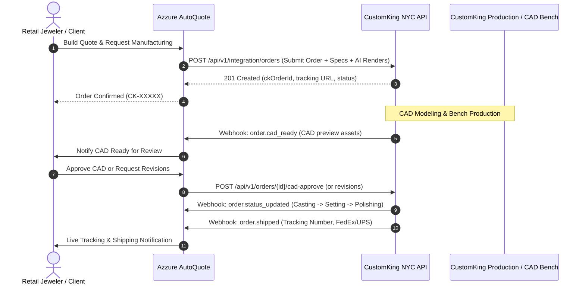

# CustomKing API Integration Specification & Requirements

**Document Version:** 2.0  
**Target Platform:** CustomKing NYC (Manufacturing & CAD Portal)  
**Client System:** Azzure AutoQuote (AI Quoting & Manufacturing Dispatch Engine)  
**Protocol:** HTTPS RESTful JSON / Webhooks  
**Date:** September 2026  

---

## 1. Executive Summary & Integration Architecture

Azzure AutoQuote empowers retail and independent jewelers to generate real-time AI-assisted quotes and instant 3D visual concepts from customer photos and specifications. Once a quote is accepted by the end-customer, the jeweler converts the quote into a **CustomKing Manufacturing Order**.

To achieve a seamless, fully automated manufacturing pipeline between Azzure AutoQuote and CustomKing NYC, AutoQuote requires a suite of RESTful API endpoints and real-time Webhook notifications.



---

## 2. Authentication & Security Requirements

All API requests sent from AutoQuote to CustomKing will include standard API key headers and Bearer token support.

### Standard Request Headers
```http
Authorization: Bearer <CUSTOMKING_API_KEY>
X-API-Key: <CUSTOMKING_API_KEY>
Content-Type: application/json
Accept: application/json
User-Agent: AzzureAutoQuote/2.0
```

### Webhook Signature Verification
Webhooks pushed from CustomKing to AutoQuote will include an HMAC-SHA256 signature in the `X-CustomKing-Signature` header calculated using a shared secret.

---

## 3. Required API Endpoints

### 3.1. Merchant & Account Verification

#### `POST /api/v1/merchants/verify`
Checks whether a jeweler store/merchant has an active, verified account with CustomKing NYC.

- **Method:** `POST`
- **Request Body:**
```json
{
  "companyName": "Diamond Vault NYC",
  "companyEmail": "orders@diamondvault.com",
  "phone": "+1-212-555-0199",
  "externalTenantId": "company_cly7x01"
}
```
- **Response `200 OK`:**
```json
{
  "success": true,
  "verified": true,
  "merchantId": "CK-M-4821",
  "accountStatus": "ACTIVE",
  "tier": "WHOLESALE_PREFERRED",
  "creditTerms": "NET_30",
  "assignedAccountManager": {
    "name": "Sarah Jenkins",
    "email": "sarah@customkingnyc.com"
  }
}
```

---

### 3.2. Order Creation & Dispatch

#### `POST /api/v1/integration/orders`
Submits a complete custom jewelry manufacturing job directly into CustomKing's production workflow.

- **Method:** `POST`
- **Request Body:**
```json
{
  "purchaseOrderNo": "PO-2026-0891",
  "jobName": "Custom 1.5ct Oval Halo Engagement Ring",
  "productType": "Ring",
  "metalType": "14K White Gold",
  "size": "6.5",
  "qty": 1,
  "polishLevel": "HIGH_POLISH",
  "matchingBand": false,
  "deliveryDate": "2026-09-25",
  "engraveMessage": "Forever & Always 09.2026",
  "fontfamily": "Script",
  "stoneSettingType": "PRONG",
  "stoneSettingDescription": "4-claw center setting, micro-pave shank",
  "stoneDetails": [
    {
      "stoneType": "DIAMOND",
      "isNatural": "LAB_GROWN",
      "shape": "OVAL",
      "carat": 1.50,
      "quantity": 1,
      "color": "E",
      "clarity": "VVS2",
      "placement": "CENTER",
      "provider": "CK_SUPPLIED"
    },
    {
      "stoneType": "DIAMOND",
      "isNatural": "LAB_GROWN",
      "shape": "ROUND",
      "carat": 0.38,
      "quantity": 24,
      "color": "F",
      "clarity": "VS1",
      "placement": "SIDE",
      "provider": "CK_SUPPLIED"
    }
  ],
  "images": [
    "https://storage.azzuresolutions.com/renders/quote_0981_render.jpg",
    "https://storage.azzuresolutions.com/customer-uploads/inspo_side.jpg"
  ],
  "note": "Client requested dainty 1.6mm band width. Please ensure tight pave gaps.",
  "customerEmail": "jeweler-orders@diamondvault.com",
  "companyName": "Diamond Vault NYC",
  "storeName": "Diamond Vault NYC",
  "externalOrderId": "ord_9182390a",
  "quoteNumber": "AQ-2026-0042",
  "callbackWebhookUrl": "https://autoquote.azzuresolutions.com/api/webhooks/customking"
}
```

- **Response `201 Created`:**
```json
{
  "success": true,
  "orderId": "CK-98432",
  "orderCode": "CK-98432",
  "customOrderId": "CK-98432",
  "ckOrderUrl": "https://customkingnyc.com/portal/orders/CK-98432",
  "status": "RECEIVED",
  "estimatedCadDate": "2026-09-08T18:00:00Z",
  "estimatedCompletionDate": "2026-09-24T18:00:00Z",
  "createdAt": "2026-09-03T11:45:00Z"
}
```

---

### 3.3. Order Status & Milestone Tracking

#### `GET /api/v1/orders/{orderId}`
Retrieves real-time progress, production phase, and shipping information for an order.

- **Method:** `GET`
- **Path Parameter:** `orderId` (e.g. `CK-98432`)
- **Response `200 OK`:**
```json
{
  "success": true,
  "orderId": "CK-98432",
  "purchaseOrderNo": "PO-2026-0891",
  "status": "STONE_SETTING",
  "statusLabel": "Stone Setting in Progress",
  "progressPercentage": 75,
  "milestones": [
    { "key": "ORDER_RECEIVED", "label": "Order Received", "completedAt": "2026-09-03T11:45:00Z", "status": "COMPLETED" },
    { "key": "CAD_DESIGN", "label": "CAD 3D Modeling", "completedAt": "2026-09-06T14:20:00Z", "status": "COMPLETED" },
    { "key": "CAD_APPROVED", "label": "CAD Client Approval", "completedAt": "2026-09-07T09:15:00Z", "status": "COMPLETED" },
    { "key": "CASTING", "label": "Wax Print & Casting", "completedAt": "2026-09-12T16:00:00Z", "status": "COMPLETED" },
    { "key": "STONE_SETTING", "label": "Diamond Setting", "completedAt": null, "status": "IN_PROGRESS" },
    { "key": "POLISHING", "label": "Final Polish & Rhodium", "completedAt": null, "status": "PENDING" },
    { "key": "QUALITY_ASSURANCE", "label": "Final QA Inspection", "completedAt": null, "status": "PENDING" },
    { "key": "SHIPPED", "label": "Dispatched / Shipped", "completedAt": null, "status": "PENDING" }
  ],
  "cadAssets": {
    "interactive3dUrl": "https://customkingnyc.com/3d/view/CK-98432",
    "renderImages": [
      "https://customkingnyc.com/cdn/cad/CK-98432_top.png",
      "https://customkingnyc.com/cdn/cad/CK-98432_side.png",
      "https://customkingnyc.com/cdn/cad/CK-98432_perspective.png"
    ],
    "stlDownloadUrl": "https://customkingnyc.com/cdn/cad/CK-98432.stl"
  },
  "shipping": {
    "carrier": "FedEx",
    "service": "Priority Overnight",
    "trackingNumber": "781293849182",
    "trackingUrl": "https://www.fedex.com/fedextrack/?trknbr=781293849182",
    "shippedAt": null,
    "estimatedDelivery": "2026-09-24T10:30:00Z"
  },
  "pricing": {
    "cadFee": 45.00,
    "castingLabor": 120.00,
    "metalCost": 485.50,
    "settingCost": 60.00,
    "totalCost": 710.50,
    "currency": "USD"
  }
}
```

---

### 3.4. CAD Approval & Revision Cycle

#### `POST /api/v1/orders/{orderId}/cad-approve`
Signals CustomKing that the retail jeweler and their end customer have approved the 3D CAD design and authorized wax printing & metal casting.

- **Method:** `POST`
- **Path Parameter:** `orderId`
- **Request Body:**
```json
{
  "approvedBy": "jeweler@diamondvault.com",
  "approvedAt": "2026-09-07T09:15:00Z",
  "approvalNotes": "Approved without changes. Proceed to 14K White Gold casting."
}
```
- **Response `200 OK`:**
```json
{
  "success": true,
  "orderId": "CK-98432",
  "status": "CASTING_QUEUED",
  "message": "CAD approved. Production queued for casting."
}
```

#### `POST /api/v1/orders/{orderId}/cad-revisions`
Submits requested modifications to the CAD model before casting starts.

- **Method:** `POST`
- **Path Parameter:** `orderId`
- **Request Body:**
```json
{
  "requestedBy": "jeweler@diamondvault.com",
  "revisionNotes": "Please lower the center stone basket by 0.8mm so it sits flush with standard wedding bands. Keep prongs delicate claw.",
  "markupImageUrls": [
    "https://storage.azzuresolutions.com/revisions/markup_basket_height.jpg"
  ]
}
```
- **Response `200 OK`:**
```json
{
  "success": true,
  "orderId": "CK-98432",
  "status": "CAD_REVISION_REQUESTED",
  "message": "Revision request received. Updated CAD expected in 24-48 hours.",
  "estimatedRevisionDate": "2026-09-09T18:00:00Z"
}
```

---

### 3.5. Instant Manufacturing Wholesale Cost Estimator (Pre-Order)

#### `POST /api/v1/pricing/estimate`
Allows AutoQuote to fetch live wholesale cost estimates from CustomKing's pricing algorithm during quote creation.

- **Method:** `POST`
- **Request Body:**
```json
{
  "productType": "Ring",
  "metalType": "18K Yellow Gold",
  "estimatedMetalWeightGrams": 5.2,
  "centerStone": {
    "type": "DIAMOND",
    "shape": "EMERALD",
    "carat": 2.0,
    "provider": "CUSTOMER_SUPPLIED"
  },
  "sideStones": {
    "type": "DIAMOND",
    "count": 2,
    "totalCarats": 0.5,
    "settingStyle": "PRONG",
    "provider": "CK_SUPPLIED"
  },
  "requiresCad": true
}
```
- **Response `200 OK`:**
```json
{
  "success": true,
  "wholesaleEstimate": {
    "cadFee": 45.00,
    "castingLabor": 130.00,
    "metalCost": 395.20,
    "stoneCost": 225.00,
    "settingLabor": 35.00,
    "totalWholesaleEstimate": 830.20,
    "currency": "USD",
    "estimatedTurnaroundDays": 12
  }
}
```

---

### 3.6. Bi-directional Job Messaging & Notes

#### `GET /api/v1/orders/{orderId}/messages`
Retrieves conversation history between CustomKing CAD designers / bench jewelers and the retail jeweler.

#### `POST /api/v1/orders/{orderId}/messages`
Sends a message or file attachment into the order's communication log.

- **Method:** `POST`
- **Request Body:**
```json
{
  "sender": "jeweler",
  "senderName": "Diamond Vault NYC",
  "message": "Can you confirm if the center prong orientation is north-south or compass style?",
  "attachments": []
}
```

---

## 4. Webhook Notifications (CustomKing ➔ AutoQuote)

CustomKing will send HTTP `POST` requests to AutoQuote's webhook receiver:  
`POST https://autoquote.azzuresolutions.com/api/webhooks/customking`

### 4.1. Supported Webhook Event Types

| Event Name | Trigger Condition |
| :--- | :--- |
| `order.status_updated` | Order moves between production phases (`CASTING`, `SETTING`, `POLISHING`, `QA`) |
| `order.cad_ready` | CAD model renders and 3D viewer link are ready for jeweler approval |
| `order.shipped` | Package is labeled and handed to courier with tracking number |
| `order.message_created` | CAD designer or bench jeweler posts a message or question |
| `order.price_adjusted` | If final metal weight or stone weight deviates and requires price update |

### 4.2. Sample Webhook Payload (`order.cad_ready`)
```json
{
  "event": "order.cad_ready",
  "timestamp": "2026-09-06T14:20:00Z",
  "data": {
    "orderId": "CK-98432",
    "externalOrderId": "ord_9182390a",
    "purchaseOrderNo": "PO-2026-0891",
    "interactive3dUrl": "https://customkingnyc.com/3d/view/CK-98432",
    "renderImages": [
      "https://customkingnyc.com/cdn/cad/CK-98432_top.png",
      "https://customkingnyc.com/cdn/cad/CK-98432_side.png"
    ],
    "notesFromDesigner": "Modeled as requested with 1.6mm delicate shank."
  }
}
```

### 4.3. Sample Webhook Payload (`order.shipped`)
```json
{
  "event": "order.shipped",
  "timestamp": "2026-09-23T17:30:00Z",
  "data": {
    "orderId": "CK-98432",
    "externalOrderId": "ord_9182390a",
    "carrier": "FedEx",
    "service": "Priority Overnight",
    "trackingNumber": "781293849182",
    "trackingUrl": "https://www.fedex.com/fedextrack/?trknbr=781293849182",
    "packageWeightOz": 12.4
  }
}
```

---

## 5. Summary Matrix of Required Endpoints

| Category | Endpoint | Method | Priority | Status in AutoQuote |
| :--- | :--- | :---: | :---: | :---: |
| **Orders** | `/api/v1/integration/orders` | `POST` | **Critical (P0)** | Client implemented (`lib/customking-api.ts`) |
| **Tracking** | `/api/v1/orders/{orderId}` | `GET` | **Critical (P0)** | Ready for live payload binding |
| **CAD Review** | `/api/v1/orders/{orderId}/cad-approve` | `POST` | **High (P1)** | Studio UI ready for action binding |
| **CAD Review** | `/api/v1/orders/{orderId}/cad-revisions`| `POST` | **High (P1)** | Studio UI ready for action binding |
| **Pricing** | `/api/v1/pricing/estimate` | `POST` | **Medium (P2)** | Optional real-time wholesale check |
| **Messaging** | `/api/v1/orders/{orderId}/messages` | `GET/POST`| **Medium (P2)** | Order timeline ready for comments |
| **Webhooks** | AutoQuote Webhook Receiver | `POST` | **Critical (P0)** | Webhook router endpoint ready |

---

## 6. Environment Endpoints

- **Staging / Sandbox:** `https://staging-api.customkingnyc.com/api/v1` (or `https://cknyc-api.azzuresolutions.com/api/v1`)
- **Production:** `https://api.customkingnyc.com/api/v1`
- **Dashboard / Portal URL:** `https://customkingnyc.com/portal`
